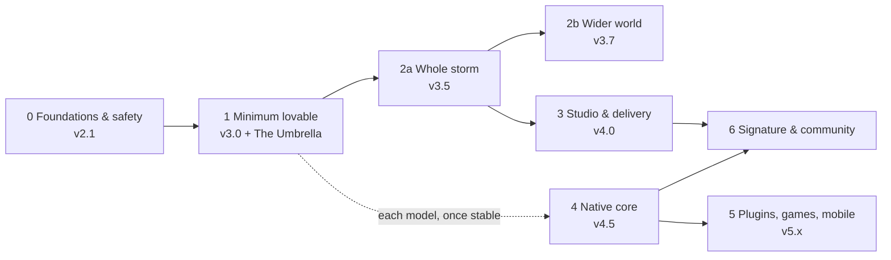
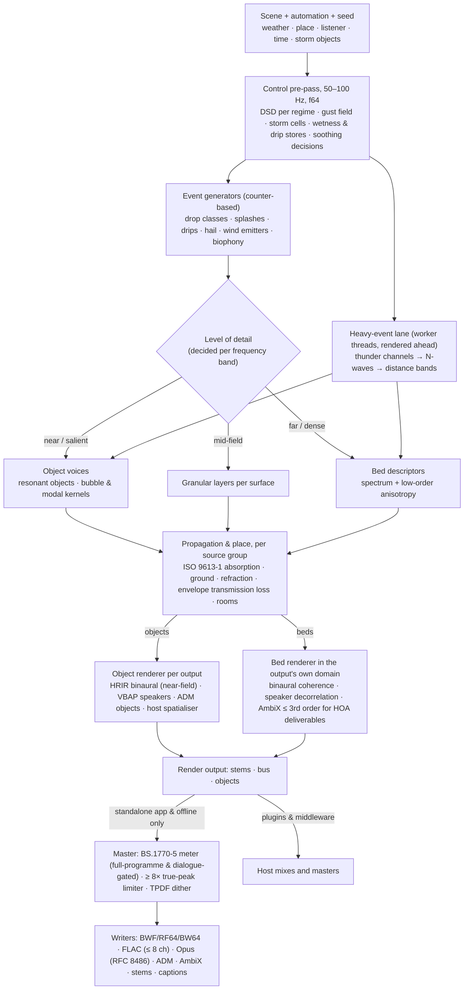

# Master Plan: from rain generator to the reference weather & environment sound engine

*Prepared 2026-11-16 for the RainGeneratorPy project. Status: draft for decision (revision 2, after five expert reviews).*

**How this plan was built.** It rests on a codebase audit with measurements and on seven research tracks (rain physics, synthesis research, environment acoustics, psychoacoustics, market, pro standards, control design) holding 234 findings. An independent fact-check then tested 114 load-bearing claims: 73 were confirmed, 31 corrected and 10 found unverifiable (none was refuted outright). Corrected values are used except where flagged. Anything still unverified is marked *(unverified)*, and every figure that must be re-checked before it appears in public copy or becomes a CI gate is tracked in the **verification debt** table (Appendix B). Five reviewers (requirements, accuracy, engineering, UX/accessibility, product ingenuity) then critiqued the first draft; this revision applies their critical and major points.

**How to read it.** Part 1 (§0–§5) is plain language: what you get, when, and what it costs. Part 2 (§6–§12) is the science and engineering behind it. Jargon is explained in plain words the first time it appears in Part 1 and is collected in the glossary (Appendix D).

| Part 1: What you get | Part 2: How it works |
|---|---|
| §0 The short version · §1 The jaw-drop moments · §2 The controls · §3 Product surfaces (incl. the 4D Environment Composer) · §4 Roadmap · §5 Decisions and budget | §6 Starting point (today's code, principles, market) · §7 The science of real weather · §8 What makes it soothing · §9 Engine architecture · §10 Professional delivery · §11 Validation · §12 Risks · Appendices A–E (numbers, verification debt, open questions, glossary, references) |

---

# Part 1: What you get

## 0. The short version

Today RainGeneratorPy is **a polished visual simulator whose audio is a simple noise generator**: filtered white noise plus a few beeps (§6.1). Its visuals also contradict the physics in places (thunder follows the flash about 3× too quickly), and its full-screen lightning flash has no rate limit. This plan turns it into **the engine people reach for whenever they need weather to sound real**, whether they are a sleepy listener, a YouTuber, a music producer, an ASMR artist, a game studio or a Hollywood dialogue editor.

**Positioning:** *Describe the weather the way you would experience it (heavy rain, a gusty westerly, a storm 3 km away, you're in a tent) and get endless, never-repeating, studio-grade sound that you fully own: as a file, as separate tracks, as cinema surround, or live inside your software.*
**Tagline:** *Weather you can direct.* ("It never loops" is a proof point, not the headline.)

### Three things nobody else can do

| | What it means for you | Why only this engine can |
|---|---|---|
| **A storm is a file** | A 10-hour storm in 7.1.4 cinema surround is 62 GB of audio, but its scene file is about 400 bytes. Share it as a link or QR code, and anyone can play the exact same storm or remix it. | The sound is a pure function of scene + random seed + engine version (§9.4) |
| **Direct the weather** | Move the storm, the wind, the shelter or the listener after the fact and re-render. A director's note becomes a slider move. Physics by default, cinematic on purpose, with every cheat labelled. | A physical model plus a labelled "cinematic" layer (§2.5) |
| **See it and hear it: the same storm** | In the 4D Composer, the lightning bolt you see is the one you hear. Its thunder wavefront crosses the valley on screen and reaches your ears at the speed of sound for that air temperature. | One stream of events drives both picture and sound (§3.5) |

### You asked for → what the plan gives → when

| You asked for | What the plan gives | Phase |
|---|---|---|
| An industry-standard **Python library** | `pip install raingen`; a plain-words and human-units API; an open, versioned scene format with a conformance suite (§3.1–3.2) | 1 (library) → 3 (format programme) |
| A **GUI app** that people actually use | A Listen app with live playback in v3.0, without waiting for the native core; the full Studio in v4.0; installers for Windows, macOS and Linux (§3.4) | 1 → 3 |
| **Games** | A real-time core with plugins for Wwise and FMOD (game-audio middleware), Unreal and Unity; surfaces and shelter sampled from the game world (§3.6) | 4 → 5 |
| **Hollywood / film and TV** | Separate tracks per sound (stems), Dolby Atmos files and timecode from the app; "Match my recording"; thunder placed automatically on lightning in the picture; AAX (the Pro Tools plugin format) early in the plugin order (§3.6–3.8) | 2a → 3 → 5 |
| **Background-noise and sleep apps** | Sleep, Focus and Relax modes, a timer that fades out, "No sudden loud sounds"; the web app installs on phones now (a PWA, an installable web app); a native mobile kit later | 1 → 2b → 5 |
| **Music artists** | Loops that are exactly N bars long at your tempo, drip one-shots tuned to a key, thunder and gust one-shot packs, a MIDI file of the storm's events: from Python and the command line first, as a plugin later | 2a → 5 |
| **ASMR creators** | Close-up 3-D headphone sound under an umbrella, in a tent or at a window; a Tingle ↔ Comfort control; remove any single sound; "performable rain" you can tap | 1 → 2a |
| **YouTube creators** | One-click 1–10 h renders, a story builder, video matched to your picture, captions. Each video can be genuinely different (different storms, places, story arcs and events) | 1 → 3 |
| **Jaw-dropping hyper-realism** | Physics-driven rain, wind and thunder; one hero demo, "The Umbrella" (§1), in the first release; blind listening-test scores published | 1 → every phase |
| **Research on nature and what makes sound soothing** | Evidence graded by strength (§7–§8), turned into a plain recipe and the mode defaults; no medical claims | 1 (modes) → 2a → 2b |
| Controls that mirror **what humans experience** (rain amount, wind speed, direction, gusts, temperature) | Three human sliders; then rain in mm/h, wind on the Beaufort scale and in km/h "from your left", gusts "up to 45 km/h", thunder as the seconds between flash and bang, and temperature labelled honestly (§2) | 1 |
| **Simple values for normal people**, who can **set their own presets** | One big Play button, three sliders, a mode and a mixer; "My presets" can be saved, renamed, shared as a link or file, and imported (§2.3–2.4) | 1 |
| **Full command for studios** | A Studio workspace with a place map, physics inspector, automation, timecode, OSC/MIDI control and the Python API (§2.6) | 1 (API) → 3 (app) |
| **Accessibility**, and a **"pathway" of control** | Two workspaces × two levels over one shared set of settings; screen reader, keyboard, captions, flash safety, contrast and translation built in (§2.7–2.10) | 0 (flash safety) → 1 → 3 |
| **The whole environment, not just rain** | Wind, thunder, hail, snow, shelters, moving storms and the aftermath; then sea surf, streams, rivers, waterfalls, campfires and fireplaces, animals and towns, the last group after a research sprint (§7.10) | 2a → 2b |
| A **4D environment maker**, like the tools Hollywood uses | The 4D Environment Composer: a 3-D world plus a timeline, first in the browser, then as the desktop Studio (§3.5) | prototype now → 1 (public v0) → 3 |

### How we deliver it

| Move | In plain words |
|---|---|
| Rebuild the sound from physics | Rain is a mix of drop sizes hitting real materials; wind is heard through trees and wires; thunder comes from a lightning-shaped source; distance changes sound the way real air does (§7) |
| Spend detail where ears can hear it | Nearby drops are individual 3-D sounds; distant rain is a statistically exact texture (§9.3) |
| One set of settings, two workspaces | Listen (simple) and Studio (full) are two views of the same settings, so nothing is lost when you switch (§2.1) |
| Deterministic and time-addressable | The same scene and seed always give the same sound, and any minute of a 10-hour render can be made on its own (§9.4) |
| Pro delivery built in | Correct loudness for YouTube, Spotify, broadcast and film; surround and Atmos; industry-standard file metadata (§10) |
| Python now, native core when ready | Python is the lab and the offline renderer. A Rust core (Rust is a fast, memory-safe compiled language) grows module by module for plugins, games, the web and phones (§9.6) |
| Prove it | Blind listening tests, published scores and a public "real or engine?" quiz (§11) |

**Status today:** a Phase 0/1 Python reference engine (`raingen/`) and a browser prototype of the 4D Composer (with a JavaScript/Web Audio engine) are being coded now. Treat both as unverified prototype code until they pass the Phase 0/1 tests and listening checks (§4).

---

## 1. The jaw-drop moments

### 1.1 The hero experience: "The Umbrella"

Put on headphones. You stand under an umbrella in a meadow as a storm rolls in.
- Rain drums on the fabric 30 cm above your head: fat drops thud, fine drizzle hisses.
- Drips fall off the rim in front of you, to your left and to your right, and puddles plink at your feet.
- A treeline 50 m upwind bends. About 5 s later the gust reaches you and sweeps past, carrying a sheet of rain.
- Thunder approaches from 8 km to 2 km. You see each flash and count the seconds.
- It ends with the reveal: *"This 4-minute storm is this 400-byte file"*, with a link to open it and remix it.
- **Extended cut, "Walk in from the storm" (Phase 2a):** you walk from under the umbrella onto a porch with a tin roof above your head, then go inside and close the window.

It ships in the first release and needs no native core. It is published three ways:

| Format | Why |
|---|---|
| A "put on headphones" video with binaural sound (3-D sound for headphones) | The format behind long-running viral binaural demos |
| A YouTube 360 upload with first-order ambisonic sound (a 4-channel 3-D surround format) | Look-around sound on any phone, with zero infrastructure |
| A page in the web 4D Composer, playing pre-rendered top-quality audio that turns with your head, plus the scene link | The shareable, remixable surface |

**The web 4D Composer is the viral surface.** A link opens a playable storm. "See the sound travel" shows the thunder wavefront moving across the landscape. "Remix this storm" copies the scene with credit to its author. Every share is both a demo and an adoption of the scene format. Hero pages play offline-rendered top-quality audio; the live engine in the browser powers the interactive toys (§3.5).

### 1.2 The demo reel

| # | Demo | What you experience | Unlocked in | Format / channel |
|---|---|---|---|---|
| 1 | **The Umbrella** (hero) | §1.1 | 1 | Headphones video, YouTube 360, web |
| 2 | **Count with me** | A flash on screen; you count; the thunder arrives exactly when physics says for that distance and air temperature, and rolls along the bolt you saw | 1 (interim thunder) → 2a (synthesized) | Web composer, short clip |
| 3 | **The 400-byte storm** | A scene file opens and a 10-hour render starts playing immediately | 1 | Web, social |
| 4 | **Gust curtain** | Trees bend upwind; ~5 s later the gust arrives and sweeps from left to right | 1 | Headphones video |
| 5 | **Same storm, four roofs** | Tin → tile → canvas → glass while the weather carries on | 2a | Web A/B |
| 6 | **Walk in from the storm** | Meadow → under an oak → porch → inside, and the window closes | 2a | Headphones video, composer walk mode |
| 7 | **Look around the umbrella** | Head-tracked 3-D sound on a phone or AirPods | 1 (pre-rendered) → 4 (live) | Web, phone |
| 8 | **The storm passes** (20 min) | A few fat drops → the downpour → a soft tail → dripping eaves → crickets returning at a chirp rate set by the temperature | 2a (crickets in 2b) | Long video |
| 9 | **Spot to picture** | Drop in a film clip; thunder is placed automatically on every detected lightning flash | 3 | Pro demo |
| 10 | **Match my recording** | 5 s of rain recorded on set becomes an endless matching bed that you can then make heavier or move | 2a (v1) → 6 (v2) | Pro demo |
| 11 | **Snow hush** | The same forest under fresh snow: the near world goes quiet and distant sounds sharpen | 2b | Web A/B |
| 12 | **Listen together** | Friends on different devices hear the same thunderclap at the same instant, with no audio streamed | 4 | Web |

**Proof points, not headline demos:** "never repeats" (a 10-hour render with a loop detector) for creators, and "real weather, right now", which is parity with Endel and Apple (§2.8).

---

## 2. The controls: the pathway from "make it cozy" to "−27 LKFS stems at 01:00:00:00"

This section answers *"controls should reflect what humans already experience: simple for normal people, full command for studios"*.

### 2.1 Shape: one set of settings, two workspaces, two levels each

The Nielsen Norman Group warns that *designs that go beyond 2 disclosure levels typically have low usability.* So the four levels are views over one shared **parameter graph** (the single store of every setting), not four nested "Advanced…" menus.

```
LISTEN workspace                            STUDIO workspace
┌─────────────────────────────────┐        ┌───────────────────────────────────┐
│ Level 1  MAIN SCREEN            │        │ Level 1  PLACE & POSITION         │
│   Play · 3 sliders · mode ·     │        │   place map / 4D viewport         │
│   headphones · timer · sounds   │        │ Level 2  ENGINEER inspector       │
│ Level 2  FINE-TUNE THE WEATHER  │        │   physics · render · integration  │
│   rain · wind · thunder · time  │        │ + timeline & automation (always)  │
└─────────────────────────────────┘        └───────────────────────────────────┘
            └──────────────── same parameter graph ────────────────┘
```

- Switching workspace never changes the sound and never loses state. A labelled toggle in the top bar (Ctrl+1 / Ctrl+2) switches, and Studio always shows a "Back to Listen" button.
- Studio's inspector reuses the same Weather group as Fine-tune, so "two levels" means depth within each workspace.

### 2.2 First run

| Rule | Spec |
|---|---|
| **No autoplay** | The app opens on one big, focused **Play** button (≥ 64 px) with the default scene, "Steady rain on leaves, night", named above it. Nothing plays until it is pressed. Browsers require this tap anyway, and screen-reader speech is never drowned out at launch. |
| **Safe starting level** | The first Play fades in over 3 s to about 35 % (≈ −30 LUFS; LUFS is the standard loudness unit), because the system volume is unknown. |
| **Zero decisions before the first sound** | Mode starts at Relax. Headphones stay off until detected or chosen; ten seconds in, a non-blocking chip asks "Wearing headphones? [Turn on 3-D sound]". |
| **Screen reader active** | Same paused start, default volume capped at 25 %, focus on Play: "Play: Steady rain on leaves, night. Button." |
| **Later launches** | Reopen the last scene, paused (or playing, per a setting). |

### 2.3 The Listen main screen (Tier 0)

| Control | What the person sees | What it drives |
|---|---|---|
| **Play / Pause** | The big button; media keys and a global pause shortcut also work | — |
| **How much rain** | Slider from "Rain stopped" to "Cloudburst", with a live caption ("Moderate rain · 5 mm/h") | Rain rate on a log path: 0 rain stopped (drips and wet ambience keep playing) · 20 drizzle 0.3 mm/h · 40 moderate 5 mm/h (default) · 60 heavy 20 mm/h · 80 very heavy 50 mm/h · 100 cloudburst ≥ 100 mm/h. Drop size follows the scene's climate, from fine drizzle to fat storm drops. |
| **How stormy** | Slider from "Still" to "Violent storm", with a caption ("Fresh breeze, gusty · thunder 8 km away") | Wind and thunder together: Beaufort force 0 → 10 (default 30 ≈ force 3, no thunder); gustiness (×0.8–×1.25 of the place's gust factor); how showery the rain is; thunder on/off, distance and rate (none below ~50, about 15 km at 60, 5 km at 80, 1.5 km at 100) |
| **Where you are** | Five stops with icons: **Out in it → Under a tree / umbrella → Porch / tent → Indoors, window open → Indoors, window shut** | Shelter and listening perspective. A scene may relabel its stops (car: Outside · Window down · Inside, wipers on). Moving between stops plays a 2–4 s "walking" transition; there are no meaningless in-between states. |
| **Volume** | 0–100 % with a hearing-safe zone (dB appears only in Studio) | Output level, behind a gentle limiter |
| **Mode** | Relax · Sleep · Focus · ASMR · Cinematic | Purpose-specific limits and defaults (table below and §8.3). A toast explains every switch and offers a way back. |
| **Headphones** | Toggle "3-D sound (headphones)" | Binaural rendering, head-tracked where the device allows. Settings → "Listening on": Headphones · Speakers · Laptop or phone speakers (adds bass enhancement) · Hearing aid / one ear (mono) |
| **Sleep timer** | "Stop after 45 min ▾", shown as "Stops at 23:45" | With "Fade out as I fall asleep" (15–20 min). On by default in Sleep. |
| **Sounds…** (the mixer) | Rows: Rain · Wind · Thunder · Drips · Nature, plus any extra source in the scene (Fireplace, Stream, Traffic). Each is Off · Quieter · Normal · Louder. Also **Tone: Darker ↔ Brighter** and **Keep volume steady** | Labelled level offsets (−∞ / −6 / 0 / +4 dB) per layer: they change what you hear, not the weather. They are saved in presets and become stems in Studio. The panel doubles as "What am I hearing?" (§2.11). |
| **Keep volume steady** | Toggle inside Sounds…, **on by default in Listen** | On: the sliders change character (density, timbre, events) while loudness stays within about ±2 LU. Off (and Studio's "Calibrated level"): level follows physics, about 17 dB per tenfold rain rate. |
| **Save** and scene cards | The scene name with [Save]; six cards (My presets first) and "More scenes…" | §2.4 |

**Mode limits.** Slider end labels change with the mode ("Heaviest for sleep").

| Mode | What it does to the sliders and sound |
|---|---|
| **Relax** (default) | Full ranges; "Keep it soothing" softens sudden events (§8.2) |
| **Sleep** | Rain tops out at "heavy"; wind ≤ force 5; thunder only ≥ 8 km away and ≤ 1 per 2–5 min; timer 45 min with fade; "No sudden loud sounds" always on |
| **Focus** | No thunder; steady pattern; gust swells ≤ ±2 dB; no birds or pitched drips |
| **ASMR** | Close-up detail; a Tingle ↔ Comfort control appears; soothing limits off except the hearing-level limit and a startle limiter |
| **Cinematic** | Full ranges; Physics ↔ Cinematic moves to the cinematic end, so the labelled cheats turn on (from Phase 2a); no soothing limits |

**One word, one meaning.** "Calm" used to mean five things. Now the mode is **Relax**; the governor is **Keep it soothing**; its meter is the **Soothing check**; the visual setting is **Animation: Gentle**; the startle guard is **No sudden loud sounds**; the descent is **Fade out as I fall asleep**; and the old "Wild" realism override is Studio's **Allow unrealistic combinations**. "Closeness" is reserved for near-field distance in ASMR.

**Spoken values** carry the human label: "How much rain, 60: heavy rain, 20 millimetres an hour."

**Alternatives, off the main screen:** the **Weather Orb** in an optional "Play with it" view (distance from the centre = How much rain, angle = How stormy; drift off by default with a visible toggle; tap-to-set, arrow keys and number fields all work); **Describe your weather** in the search box of More scenes; **Surprise me** and **Weather outside now** as cards.

### 2.4 My presets ("a storm is a file")

| Action | Spec |
|---|---|
| **Save** | [Save] sits next to the scene name. One press saves a card with an automatic, literal name built from the changes ("Rain on leaves · heavier · on the porch"). The name field opens focused and Enter keeps the name. Toast: "Saved to My presets. [Rename] [Undo]" |
| **What is saved** | The scene; every adjusted and locked value; mode; mixer; timer; "Listening on". Volume only if "Also remember volume" is ticked. "Exact same sound every time" stores the seed; when it's off you get the same weather with a new variation each play. |
| **Rename · Duplicate · Delete** | From the card menu (right-click, Shift+F10 or long-press). Delete shows an Undo toast instead of a confirmation dialog. |
| **Share** | "Copy link" or a QR code. The compressed scene (~400–600 bytes) travels inside the link itself (`#s=…`), so no server is needed and nothing is uploaded. Or save a `.wxscene` file. The receiver sees "Rain on a tent · 8 mm/h · wind from the west, force 5 · thunder 3 km. [Play] [Save to My presets]". |
| **Import** | Drag and drop, File › Open, or paste a link into the search box |
| **Lineage** | Every scene carries `author` and `parent` fields, so remixes keep their credit (§3.2) |
| **Version mismatch** | "Made with a newer version. 2 settings aren't supported here and were skipped. [Details]" |
| **Empty state** | "Nothing saved yet. Change any scene and press Save to keep it here." |
| **Library and CLI** | `scene.save("my_rain.wxscene")`, `rg.Scene.load(path_or_link)`, `scene.share_link()`, `raingen render my_rain.wxscene` |
| **Studio extras** | Folders and tags; "Save A/B snapshot as preset" |
| **Legacy presets** | The five v2 presets become named scenes: drizzle → "Light drizzle on leaves", steady → "Steady rain at night", thunderstorm → "Distant thunderstorm", gale → "Cold gale with rain", cozy → "Rain outside, cozy room" (complete once windows and rooms land in 2a) |

**Scene-card naming rules.** Each card has a literal *what + where + when* name ("Rain on a tent, night"), an optional mood subtitle, an icon, a one-line description, "Good for" hints (Sleep, Focus…) and a link to its evidence note. A scene has **one name everywhere**: card, button, file name and spoken label. (Today one preset is "Nostalgia" in the HUD but "Window" on its button.) Film, Game and Music tags appear only in Studio's library filter.

**Factory scenes** (about 24 by Phase 2b):

| Phase | Scenes |
|---|---|
| 1 | Steady rain on leaves, night (default) · Under the umbrella · Rain on a tent · Rain on a tin-roof porch · Rain on the street · Downpour on the pavement · Light drizzle on leaves · Distant thunderstorm (interim thunder) · Cold gale with rain · Plain white / pink / brown noise |
| 2a | Walk in from the storm · Thunderstorm on a tin roof · In the car, wipers on · Rain on the window, inside · Forest gale · The storm passes |
| 2b | Snowy forest hush · Hail on the car · Rain on the sea · Stream in the rain · Campfire in light rain · Fireplace, storm outside · Frogs after a summer storm · City rain at night |

### 2.5 Fine-tune the weather (Tier 1)

Four collapsible cards, each with a one-line summary when collapsed, plus the Cinematic macro. Every value shows a plain label and a number in the user's units.

| Card | Controls (range, default) | Notes |
|---|---|---|
| **Rain** | **Type:** None · Drizzle · Rain · Freezing rain · Rain-and-snow mix · Ice pellets · Snow · Hail (with a "with rain" sub-toggle) · **Amount:** 0.02–150 mm/h on a log slider (4) · **Drop size:** Fine · Medium · Big (captions from "misty hiss" to "fat summer-storm drops") · **Character:** Steady · On and off · Showery (about every 12 min) · **Hail size:** pea 6 mm … golf ball 44 mm (only shown for Hail) | Amount detents follow the WMO (World Meteorological Organization): slight < 2.5, moderate 2.5–10, heavy 10–50, intense > 50 (the WMO calls its own "violent" label confusing), cloudburst ≥ 100; drizzle 0.1 / 0.5. Labels follow the locale (WMO or US/AMS), and the number is always shown. The word "sleet" comes from a locale table (UK: rain-and-snow mix; US: ice pellets). |
| **Wind** | **Strength:** Beaufort 0–12, continuous (3), readout in km/h, mph, m/s or knots, with the official Beaufort land description as a live caption ("leaves and small twigs in constant motion") · **Gusts:** None · Light · Strong · Violent, read out as "gusting to 45 km/h" · **Comes from:** a dial relative to you first ("from your left"), the compass second | "From", not "to", is labelled explicitly. The technical gust factor appears only in Studio. |
| **Thunder** | On/Off · **Seconds between flash and thunder:** about 1–73 s (0.3–25 km at 20 °C), default 23 s (8 km), shown both ways · **Getting closer · Staying put · Moving away** · Flashes per minute 0–20 | Seconds are the unit people actually count |
| **Time & temperature** | Temperature −30 to +45 °C (12) · Time of day (clock, or Dawn/Day/Dusk/Night) · Season (automatic from date and hemisphere; "Wet / Dry season" in the tropics) · **Storm arc:** Arriving / Steady / Passing / Clearing over 5–120 min | Shown in the UI: *"There is no audible cold-wind sound. Temperature changes what falls (rain, sleet or snow), the insects, ice on twigs and the thunder delay."* |
| **Physics ↔ Cinematic** | 0 = physical (default) … 100 = cinematic | Turns on **labelled cheats**: a sub-bass layer under thunder, exaggerated near detail, emphasis on hero drops, a rumble that starts before a strike, and a brief dip of the rain before big events. Each renders to its own "sweeteners" track and is recorded in the file's history. **Honest = labelled** (principle 3, §6.2). Phase 2a. |

Moved to Studio: humidity (it only brightens distant sounds), cloud cover, visibility and pressure trend (inaudible; used for visuals and storm logic only).

### 2.6 Studio (Tiers 2 and 3)

**Place & position** (Studio level 1):

| Group | Contents |
|---|---|
| **Place** | Deciduous or conifer forest, meadow, coast, lake, river bank, city street, suburb, alley, mountain ridge, desert, jungle, farm, campsite. Each sets terrain roughness z₀ and displacement height d, vegetation, ambience beds and reverb. Coast, lake and river are labelled "rain only" until the water-body models land in 2b. |
| **Shelter** | Open, under a tree, umbrella, tent, porch, car (with wipers), room (window opening 0–100 %), attic or tin roof, cave mouth, underpass |
| **Surface mix** | % coverage of leaves, grass, soil/mud, puddles, asphalt, concrete, gravel, metal, tile, glass, fabric, wood, car body, snow. Wetness 0–1 per surface, automatic from the rain history. |
| **Emitters** | Gutters and downspouts, eave drips, chimes, flags, power lines (whistle from force 6), trees (count, distance, species), creaks; from 2b: stream, surf line, campfire/fireplace, traffic |
| **Ambience beds** | Crickets (chirp rate from temperature), frogs, Nature packs (birds), traffic, distant hum: automatic and overridable |
| **Aftermath** | Drip decay 1–30 min, runoff, wet-tyre hiss |
| **Position** | Height 0.3–30 m, heading, perspective (ears/binaural, close surfaces, spaced microphone pair, room), microphone distance, head-tracking source |
| **Wind at your ears** | Reported wind is measured at 10 m over open terrain (z₀ ≈ 0.03 m). The engine converts it in two steps, up to a blending height z_b ≈ 60 m with the open-terrain profile and then down with the local z₀ and d: u(z) = u₁₀ · [ln(z_b/0.03) / ln(10/0.03)] · [ln((z−d)/z₀) / ln((z_b−d)/z₀)]. This is valid only for z ≥ max(2–3 × obstacle height, z₀ + d). Below that (street canyons, under a canopy, a listener at 0.3 m) a provisional, clearly labelled empirical factor is used. Typical: ~70 % of the reported wind at 1.6 m over open land; roughly 40 % or less in suburbs, cities and forests *(provisional)*. |
| **Output** | Stereo, binaural, 5.1, 7.1.4, ambisonics (AmbiX) 1st–3rd order; width 0–150 % |

**Engineer** (Studio level 2, inspector tabs):

| Tab | Contents |
|---|---|
| Precipitation physics | Drop-size distribution family (Marshall–Palmer or normalized gamma, μ −2…10), N₀/Nw, Λ or Dm override, size cutoffs, class-boundary set (Medwin or Nystuen), fall-speed law, bubble model, bubble ξ and ε, splash density, **disdrometer CSV import** (a disdrometer measures real drop sizes on set) |
| Materials | Modal frequencies, loss factors, radiation efficiency, panel thickness, membrane tension, wetness drain |
| Wind physics | z₀, d, stability (stable night / neutral / unstable day), turbulence intensity 0.05–0.5 at listener height, gust factor 1.0–2.5 at 10 m (automatic from Place: sea 1.28 · water 1.39 · open 1.5 · suburb 1.8 · forest/town 2.15), spectrum (normalised Kaimal or von Kármán), integral scale, Strouhal number, lock-in |
| Thunder & propagation | Channel top (default 5–7 km), tortuosity, stroke count (merged for visuals), stroke intensity, lapse rate or inversion, ground model (Delany–Bazley within its validity range; Miki or layered for snow), flow resistivity, refraction method (§7.8) |
| Cinematic cheats | Thunder sub-bass sweetener 20–80 Hz · perspective cheat (keep near detail when "far") · hero-drop transient emphasis · pre-lap rumble N s before a strike · story duck of the bed before big events. Each has its own stem and provenance flag. |
| Randomness | 128-bit root seed in hex (shorter literals are zero-extended), per-layer keys, variation index, seed lock |
| Smoothing | Time to 99.5 %: rain 3 s, wind 1 s, distance 2 s, macros 0.25 s, live data 60 s (mechanism in §9.5) |
| Render | 48 kHz canonical, 96 kHz for Cinematic (44.1 kHz on request); 24-bit or 32-bit float; quality tier; ambisonic order ≤ 3; K object voices; loop length in seconds or in bars at a BPM; stems; destination profile (§10); "Calibrated level" |
| Integration | Automation lanes (linear, hold, bezier, exponential) in seconds, bars and beats, or **SMPTE timecode**, with write, latch and touch recording. MIDI learn: 7-bit (smoothed), 14-bit CC pairs, NRPN, soft takeover (at 7 bits each step of a log rain slider is a ~7 % jump, so smoothing is mandatory). OSC with bundle timetags. Wwise/FMOD parameter export. Python API and CLI. |

### 2.7 How the levels cooperate without fighting you

Every parameter is in one of three states, shown in plain words: **Following scene** (or "Following How stormy", "Following live weather"), **Adjusted** (a stored offset on top of what it follows) or **Locked** (ignores its driver). The engine calls these Auto, Offset and Pinned internally; users never see those words.

| Rule | Spec |
|---|---|
| **One driver per parameter** | Declared in the manifest (`driver: listen.how_stormy`). How much rain → rate and drop size; How stormy → wind, gustiness, showeriness and thunder; Where you are → shelter and perspective. No parameter has two slider drivers. |
| **Dragging adjusts; locking is explicit** | A direct drag creates an Adjustment. "Lock" is a separate action (Studio has a "Lock on edit" preference). |
| **Offsets in perceptual units** | Log-scaled values (rain rate, distances) store ratios, shown as "×1.5" in Studio and "a bit heavier than the scene" in Listen. Beaufort, dB and °C offsets add ("+1 Beaufort"). |
| **Discrete values** | Types, shelter, place and on/off switches are only Following or Locked; any user change locks them, so "Thunder off" stays off. |
| **Limits** | The unclamped adjustment is stored, and "(at limit)" shows while it is clamped. |
| **Visible ↺ Reset** | Every adjusted control shows a ↺ Reset button (≥ 24 × 24 px, keyboard-focusable, accessible name "Reset wind speed to follow How stormy"). The context menu (right-click, Shift+F10, long-press) offers Follow · Keep my adjustment · Lock this value · Reset. Nothing depends on Alt-click. |
| **What Listen shows** | Never the state words. Under an adjusted Fine-tune slider, one line: "You made this a bit heavier · ↺ Reset". |
| **What Studio shows** | A link-chain button per row; a hollow "ghost" thumb where the driver would put a locked value ("Would be 12 mm/h if following"); badges only for non-default sources (Live, Automation, Manual, Keep it soothing). |
| **Priority** | Automation lane → lock → (live data or slider) + adjustment → scene default. On an automated parameter the inspector says "Automated: your lock is ignored while this lane is active"; touch or latch recording overrides it. |
| **Undo, reset and history** | Listen: a visible ↶ Undo after any change (Ctrl/Cmd+Z; redo Shift+Ctrl/Cmd+Z); a visible "Reset this scene"; a History list of recent changes (tap one to go back); after Surprise me, "↶ Back to what I had" stays visible for 10 s and the last 10 surprises go to Recently played; leaving unsaved tweaks shows "Your changes are in Recently played. [Save them]". Studio: a history panel with named steps ("Wind 30 → 45 km/h"). One gesture is one undo step. |
| **Surprise me** | Samples only inside the listener-validated "realistic zone" and respects locks. Studio adds "Allow unrealistic combinations". |
| **Keep it soothing is visible** | When it intervenes, a badge and a short note appear ("Thunder softened for Sleep. [Turn off]"); it can be turned off outside Sleep. |
| **Slew everywhere** | Live-weather updates crossfade over 30–120 s. |
| **Safety sits outside the graph** | The flash limiter, "No sudden loud sounds" in Sleep and the hearing-level limits can't be switched off by presets, automation, Surprise me or sliders; only by the user, in Settings. |
| **Session journal** | Every non-repeatable input (live-weather fetches, text-parser output, Surprise-me draws, gestures, MIDI, soothing decisions) is written into the scene's automation with sample timestamps, so a live session re-renders exactly. |

### 2.8 Every other way in (all write the same graph)

| Entry point | What it does | Phase |
|---|---|---|
| **Describe your weather** | A deterministic parser for known vocabulary ("force 6", "gale", "30 mph gusts", "tin roof", "night"). It shows editable chips: "Understood: Rain · heavy · Tin roof · Night │ Not understood: 'spooky' [Did you mean 'stormy'?]" and applies on Enter. An optional AI step can fill gaps, but must output a valid scene that is shown before it is applied. The box states its languages ("English for now"). | 1 (parser) → 3 (AI option) |
| **Open a scene link or file** | §2.4 | 1 |
| **Weather outside now** (live) | A card. While it plays, a header chip reads "Live · Leeds · Light rain 1.2 mm/h · SW 18 km/h · updated 6 min ago · Weather data: Open-Meteo.com (CC BY 4.0)". The sliders re-centre on a "Live" tick and become offsets ("Lighter than outside ↔ Heavier than outside", plus "Back to live"). **When it's dry:** "It's dry in Leeds right now (12 °C, light breeze). [Play the last rain] [Play the forecast rain] [Pick a scene] [Add rain anyway]"; "Add rain anyway" keeps wind, temperature and time live. Only an approximate location (rounded to 0.1°, ~10 km) is ever sent; city search replaces it if permission is denied. Only category changes are announced. | 3 (library earlier) |
| **Paste a METAR** (an airport weather report; Studio and CLI) | `KJFK 121755Z 21016G24KT 1SM +TSRA BR BKN015CB 18/17 A2990` → wind 210° at 16 kt gusting 24, heavy thunderstorm rain, mist, 18 °C. Thunder distance follows US automated-station rules (TS ≤ 5 NM, VCTS 5–10 NM, "LTG DSNT" 10–30 NM). A squall follows FMH-1 (a sudden ≥ 16 kt increase sustained at ≥ 22 kt for ≥ 1 min). A thunderstorm "ends" 15 min after the last thunder or lightning, which triggers the storm arc's Clearing phase. | 2a |
| **Replay a date** | ERA5 reanalysis back to 1940 (lags ~5 days) or ECMWF IFS 9 km from 2017 (no lag): "Hear the Great Storm of 15–16 Oct 1987", "the rain on the night you were born" (check each data licence) | 3 |
| **Match my recording** | **v1:** matches spectrum and drop-density statistics by searching a precomputed grid of scenes and then refining, giving an editable scene and stems. **v2:** simulation-based inference (SBI, a statistical method that infers the physical settings behind a recording) | v1 2a · v2 6 |
| **Spot to picture** | §3.4 | 3 |
| **Python, CLI, OSC, MIDI, timeline** | For studios and scripts | 1 → 3 |

**Live-data caveats (Open-Meteo).** Hourly precipitation is a preceding-hour sum and hourly gusts a preceding-hour maximum; `current` values are built from 15-minute data, where gusts are the preceding-15-min maximum (native only in North America via NOAA RRFS, interpolated elsewhere). The 29 WMO weather codes include 97 "heavy thunderstorm", which must map to thunder. `lightning_potential` exists only for Central Europe (ICON-D2), so elsewhere thunder comes from codes 95/97, CAPE or METAR. Grid values sound static, so the engine adds stochastic sub-grid showers and gusts. Requests use "Best Match" models, because several named models are discontinued in Nov 2026. The free API is non-commercial (apps with ads or subscriptions count as commercial), and all Open-Meteo data, free or paid, is CC BY 4.0 and needs attribution.

**Error states** (non-modal status messages; focus moves only when you must act):

| Situation | Message |
|---|---|
| Partly unreadable METAR | "Couldn't read 'A2990X'. Everything else was applied: wind from 210° at 16 kt gusting 24 kt, heavy thunderstorm rain, mist, 18 °C. [Edit]" (bad token underlined) |
| Not a METAR | "That doesn't look like a METAR. Example: KJFK 121755Z 21016G24KT 1SM +TSRA … [Paste example] or try Describe your weather." |
| Stale report | "This report is from 3 h ago. [Use it anyway] [Get latest for KJFK]" |
| No precipitation reported | "No rain reported at KJFK. [Use wind and temperature only] [Add rain]" |
| Offline | "Can't reach the weather service. Still playing the last live weather (42 min old). Trying again every 5 minutes." It never goes silent and crossfades on reconnect. |
| Rate-limited (HTTP 429) or key rejected | "Live weather is busy; trying again in 10 min." / "Your weather key was rejected. [Check key] [Use free source]" |
| AI suggestion rejected | "The AI suggestion didn't make a valid scene, so nothing changed. [Show what was understood]" |
| Audio device lost | "Headphones disconnected, so we paused. [Resume on speakers]". It never falls back to speakers on its own at night. |
| Not enough disk | Caught by the render preflight before starting (§3.4) |

### 2.9 Accessibility and inclusion (built in, not bolted on)

| Area | Spec | Phase |
|---|---|---|
| **Flash safety** | A visual flash limiter: ≤ 3 flashes per second across automatic and manual lightning, no saturated-red flashes, multi-stroke lightning merged. WCAG (the web accessibility standard) uses lightning as its own worked example for criterion 2.3.1. Exported video always passes through the limiter plus a PEAT-style flash check. Screen shake is off by default and never runs with Gentle/Off animation or reduced motion. | **0** |
| **Screen readers** | Every control has an accessible name and a spoken value with the human label ("Wind: force 5, fresh breeze, 30 kilometres per hour from your left"). No autoplay (§2.2). Announcements only for changes the user made and for errors, at most one per 10 s. Weather-event announcements and caption sounds are **off by default**, opt-in ("key moments") and have their own volume. | 1 → 3 (audit) |
| **Keyboard** | Everything works from the keyboard: arrows for fine steps, PageUp/PageDown for coarse. On scene cards the arrows only move focus and Enter/Space plays ("Preview on focus" is opt-in). A global pause shortcut and the media keys work everywhere. | 1 |
| **No-drag alternatives** | **Timeline:** a "Points" table per lane (Time · Value · Curve), "Add point at playhead" (P), next/previous point (Alt+→/←), "Go to time…" (Ctrl+G, accepts 01:02:03:10), playhead read out on demand, a Markers list. **Place map and 4D viewport:** a **scene outline** list of every object with Distance and Bearing number boxes; arrow keys move the selection 0.5 m (Shift: 5 m); click-to-place. **Orb:** arrow keys, number fields, tap-to-set. **Meters:** values as text you can query, not chatty live regions. | 3 |
| **Contrast and text** | Theme colour tokens with a CI check: text ≥ 4.5:1, controls and slider tracks ≥ 3:1. **Okabe–Ito colours are for telling categories apart, not for contrast**, and always come with an icon or text. OS text size honoured; body text ≥ 16 px; layout verified at 200 % zoom with nothing cut off; touch targets ≥ 44 px in Listen. Controls never auto-hide while focused, while a screen reader runs, or when "Keep controls visible" is on (the default for new users). | 1 → 3 |
| **Animation** | Animation: Full · Gentle · Off; honours the OS reduced-motion setting; the app runs fine audio-only. | 0 → 1 |
| **Captions** | A sound-captions panel plus SRT/VTT export. Levels: Off · Key moments (thunder; rain starting, stopping or changing category; shelter changes; default for renders over 1 h) · Detailed (gusts, notable drips). Events within 10 s merge; each shows ≥ 1.5 s; ≤ 2 lines. Style: "[Distant thunder rumbles to the west]"; the data form stays in the cue CSV. | 2a |
| **Hearing** | Mono, balance, "Listening on: hearing aid / one ear", hearing-profile EQ. Profiles: Adult · Child · Sensitive hearing (no event > +3 dB, 55 dBA ceiling) · Misophonia-safe (removes tapping, clock-like drips and wet clicks; turning the volume down doesn't help misophonic listeners). | 2b |
| **Bedside / night screen** | Black, dimmed, no animation; any key or a tap anywhere pauses or resumes. OS media controls (MPRIS, SMTC, Now Playing). Pause when headphones disconnect. Keep playing in the tray when the window closes. When a limit acts: "Volume lowered to protect your hearing (weekly listening limit reached). [Why?]" | 1 (screen) → 2b (limits) |
| **Keyboard-shortcut policy** | No single-key shortcuts without a modifier unless they work only while their region has focus, or can be remapped or turned off (WCAG 2.1.4). Space drives the transport only when the timeline or canvas has focus. "?" or F1 opens a shortcut sheet, and every shortcut also appears in a menu. (Today's bare M, G, H, L, S and 1–5 keys are fixed in Phase 1.) | 1 |
| **Phones and touch** | Listen as an installable PWA over the web engine now; native shells (Swift/Kotlin over the Rust core) later, or sooner if locked-screen playback fails in the browser. Tapping a slider's track steps it; long-press opens the menu; nothing is hover-only; lock-screen controls via the Media Session API. A 45-minute screen-off playback test on iOS and Android runs in Phase 1. | 1 (PWA) → 5 (native) |

### 2.10 Language, units and locale

- **Stored units:** m/s, mm/h, °C (kelvin inside physics), hPa, m, degrees true "from". **Displayed** per quantity from the locale, with overrides (UK: mph with °C; aviation: knots). **Parsing** is locale-aware ("12,5" vs "12.5") and requires units.
- The manifest stores **message keys** (label, short label, description, spoken template), not English text. Spoken values use ICU MessageFormat (plurals, units). A translation pipeline (Fluent or Qt Linguist) starts in Phase 1.
- Beaufort and rain-intensity names come from official national translations.
- **Right-to-left languages:** the layout mirrors, but audio-spatial controls (balance, "wind from your left", place map, compass) and the timeline's time axis never do. Numbers and units sit inside Unicode bidi isolates.
- Claims-linter word lists exist per language (§8.4); 12/24-hour clocks follow the locale.

### 2.11 "What am I hearing?"

`scene.describe()` in the library, and the Sounds… panel in the app, list in plain words every active layer and what drives it ("Drips from the gutter · 4 m, left", "Wind in the trees · force 4", "Thunder · 8 km west, 23 s after each flash"), plus which controls currently make an audible difference (the honest audibility table, §7.8). It turns the honest-controls principle into a learning path from Listen to Studio, and works for children and teachers.

### 2.12 One manifest generates everything

A single schema file is the source of truth. Each parameter has an id, human unit, range, default, scale (linear, log, Beaufort), driver, tier, smoothing time, audibility tag, message keys, keyboard steps, OSC address, MIDI hints, Wwise/FMOD type and UCS hint. Code generation produces the typed Python API, GUI controls with accessible names and spoken values, CLI flags, the OSC namespace, MIDI-learn targets, Wwise/FMOD definitions and the docs.

- **One canonical id per parameter, the same everywhere:** `weather.precipitation.rate_mm_h`, `weather.wind.speed_m_s`, `weather.wind.from_deg`, `weather.thunder.distance_km`. That id is the Python attribute path, the YAML key, the timeline id, the OSC address (`/wx/weather/precipitation/rate_mm_h`) and the game parameter name. Setters accept unit strings (`"8 mm/h"`, `"W"`, `rg.beaufort(5)`). Events live in the same tree (`scene.weather.thunder.strike()`). `mode` (why you're listening) and `destination` (the delivery spec) are separate concepts.
- **CI lint fails on:** missing message keys or untranslated shipped strings; colour tokens below the contrast targets; unnamed nodes in the accessibility tree (an AT-SPI dump on the Linux runner); flash-rate violations in rendered visuals; any docs code sample that doesn't run against the manifest.

---

## 3. Product surfaces

### 3.1 Python library

```python
import raingen as rg   # placeholder name until the naming decision (§5)

# 1 · Just listen (blocks; Ctrl+C stops; in Jupyter it returns an audio widget)
rg.play("rain on a tent, gusty, distant thunder")

# 2 · Plain words → file (streams to disk; any length)
report = rg.render("rain on a tin roof, wind 30 km/h from the west, distant thunder",
                   minutes=60, out="cabin_storm.flac", destination="youtube")
print(report)   # Understood: rain · tin roof · wind 30 km/h W · thunder distant │ Ignored: —

# 3 · Human units, one canonical id per parameter
scene = rg.Scene.load("tent-in-a-storm")
scene.weather.precipitation.rate_mm_h = 8          # or "8 mm/h"
scene.weather.wind.speed_m_s = rg.beaufort(5)      # shown as 29–38 km/h, "fresh breeze"
scene.weather.wind.from_deg = "W"                  # meteorological "from"
scene.weather.thunder.distance_km = 3              # ≈ 8.7 s flash-to-bang at 20 °C
print(scene.describe())                            # "What am I hearing?" in plain words
scene.save("my_tent.wxscene"); link = scene.share_link()

# 4 · Long renders run detached: progress, cancel, resume after a crash
job = scene.render(hours=10, seed=42, out="tent.flac", destination="sleep")
print(job.progress()); job.result()                # or job.cancel()

# 5 · Studio: automation, explicit events, stems, Atmos, timecode
scene.timeline.ramp("weather.precipitation.rate_mm_h",
                    [(0, 0.5), ("05:00", 25), ("12:00", 2)], curve="log")
scene.weather.thunder.strike(at="06:12.08", distance_km=1.2, bearing="NW")
scene.export(stems=True, layout="7.1.4", adm=True, ucs=True,
             timecode_start="01:00:00:00", destination="post-stems")

# 6 · Music: loops that are exactly N bars, one-shots and a MIDI file of events
scene.render_loop(bars=8, bpm=84, out="rain_loop_84bpm.wav")   # seamless; loop points written
rg.one_shots("thunder", count=12, out_dir="thunder_pack/", ucs=True)
scene.export_events_midi("storm_events.mid")

# 7 · Variations for a sound library or a game
for v in scene.variations(20):                      # derived seeds, UCS-compliant names
    v.render(seconds=90, out_dir="lib/")

# 8 · Real time (Phase 1: reduced-detail Python tier; Phase 4: native core)
with rg.Engine(scene) as eng:
    eng.set("weather.wind.speed_m_s", 14, ramp=2.0)  # unit-suffixed id, so a bare number is fine
    eng.set("listener.shelter", "car")
```

**API rules**
- `rg.render(..., strict=False)` returns a ParseReport; `strict=True` raises `SceneParseError` with suggestions.
- Bare numbers are accepted only on unit-suffixed ids (`rate_mm_h=8`). Otherwise: `ValueError: weather.precipitation.rate needs a unit, e.g. "8 mm/h"`.
- `render()` takes a frozen, validated snapshot of the scene and its automation, so editing `scene` afterwards never affects a running job.
- `eng.set()` is safe to call from several threads (a multi-producer queue) and carries an absolute engine-sample timestamp or explicit "as soon as possible" semantics. Python callbacks are polled on the caller's thread and never invoked from engine worker threads.

### 3.2 The scene file and the format programme

```yaml
format: wxscene/1            # neutral key, independent of the product name
$schema: https://example.org/wxscene/1.schema.json
engine: "4.0.2"              # exact build for a bit-exact re-render; ">=4.0" for a semantic one
seed: 0x5EEDCAFE             # 128-bit; shorter literals are zero-extended
author: "Your Name"          # credit
parent: "sha256:…"           # remix lineage
weather:
  precipitation: {type: rain, rate_mm_h: 8, drop_size: medium, character: showery}
  wind: {speed_m_s: 9.5, from_deg: 270, gusts: auto}         # 9.5 m/s = force 5
  thunder: {enabled: true, distance_km: 3, approach_kmh: 15, flashes_per_min: 2}
  temperature_c: 14
  humidity_pct: 92
  time: night
place:
  preset: conifer-forest
  shelter: tent
  surfaces: {needles: 40, soil: 30, puddles: 10, tent_fabric: 20}
listener: {height_m: 0.5, heading_deg: 0, render: binaural}
mode: sleep
mix: {rain: 0, wind: 0, thunder: -6, drips: 0, nature: off}
timeline:
  - {at: "00:00", set: {weather.storm_arc: arriving}}
  - {at: "20:00", set: {weather.storm_arc: clearing}}
```

The scene, seed and engine version are embedded in every export (BWF iXML and bext CodingHistory; a Vorbis comment in FLAC), so **any file can be reopened, tweaked and re-rendered**. A format becomes a standard through adoption mechanics, not just publication:

| Element | Spec |
|---|---|
| Spec separate from the engine | The format spec has its own version number and deprecation policy |
| Two conformance levels | **Semantic:** every parameter means the same physical quantity in any engine. **Exact:** a pinned engine build re-renders bit-identically (same block size). |
| Engine-version pinning | Every released core is archived as an immutable WebAssembly build addressable by version, so an old file re-renders exactly, forever |
| Extensions | An `x-vendor` namespace |
| Conformance suite | Built from the golden test scenes (§9.4) |
| Free player | A permissively licensed, embeddable `<weather-scene src=…>` web component |
| Importers and exporters | METAR and WMO weather codes in; Wwise, FMOD and Unreal manifests out; a proposed OpenUSD schema for VFX pipelines |
| Governance | A public spec repository, changes by RFC, and a neutral home once third parties adopt it |

### 3.3 CLI

```bash
raingen play "rain on a tent, gusty"
raingen render "heavy rain on a car roof, wipers on" --minutes 30 --out car.flac --destination youtube
raingen render my_tent.wxscene --hours 10 --layout binaural --destination sleep
raingen loop my_tent.wxscene --bars 8 --bpm 84 --out loop.wav
raingen variations scene.wxscene --count 20 --ucs --out ./library/
raingen metar "KJFK 121755Z 21016G24KT 1SM +TSRA BR BKN015CB 18/17 A2990" --minutes 10
raingen match production_rain.wav --minutes 5 --stems
raingen spot reel.mov --distance 3km --bearing NW --out thunder_stems/
python -m rain_generator        # the v2 entry point keeps working (§4.12)
```

### 3.4 Desktop app (Listen + Studio)

| Part | Spec | Phase |
|---|---|---|
| **Live preview** | A reduced-detail Python real-time tier (kernels compiled with Numba, ~16 close-up voices, a stereo or first-order ambisonic bed) feeding the sound card from a render-ahead thread. Full quality is one click away: "render 30 s, then play". | 1 |
| **Listen workspace** | §2.2–2.4. The visualizer becomes a calm scene view driven by the **same event stream** as the audio: every close-up voice gets a drawn splash at its exact time and place; distant rain is drawn as particles whose density follows the computed impact rate; one gust field drives tree sway, rain slant and the audio gusts. | 1 |
| **Render for…** | YouTube 10 h · Sleep · Podcast · Phone · Music loop. **Render preflight** before starting: "10 h · stereo FLAC · ~8 GB · about 25 min on this computer · saving to Videos/Rain ✓ 120 GB free". It warns below 1.2× the needed space and suggests FLAC or split files. While running: time remaining, Cancel, progress announced at 25/50/75/100 %, resume after a crash. When done: "Saved cabin_storm.flac. [Show in folder] [Make video] [Copy captions]". | 1 |
| **Story builder** | 3–5 cards in sequence, e.g. [Arriving · 10 min] → [Downpour · 20 min] → [Passing · 15 min] → [Drips and crickets · 10 min]. Each card is a scene state plus a duration and builds automation behind the scenes; Studio opens the result as lanes. | 2a (library/CLI) → 3 (app) |
| **Studio workspace** | The 4D viewport and place map (§3.5); the inspector with provenance badges; timeline with automation lanes and timecode; meters for loudness (momentary, short-term, integrated, in both measurement modes, §10), true peak, loudness range, sharpness, a "Soothing check" that counts sudden sounds, and hearing level; loudness-matched A/B/C/D snapshots (otherwise the louder one always wins); history; an export dialog keyed by destination (§10) | 3 |
| **Creator video** | Visuals plus audio to MP4 through an external ffmpeg, up to 4K/60, flash-safe always, with scene-matched views (a window with droplets, a forest, a tent). **Picture-matched video:** drop in your thumbnail or a short loop; an optional vision-model step proposes a scene (shown before applying); rain, splash and lightning overlays render from the same event stream, so flashes lock to the thunder delay; one click gives a 1–10 h MP4 with its provenance. | 3 |
| **YouTube, honestly** | The app helps you make each video **genuinely different, audibly and visibly**: different storms, places, story arcs and events with matching visuals, not just a different seed in the metadata. It cannot guarantee monetisation; YouTube decides that. A variation check warns when a new render is too similar to your earlier ones. | 3 |
| **Spot to picture** (film) | Import the QuickTime reference; lightning flashes are detected from jumps in frame brightness and become frame-accurate strike markers; set distance and bearing per strike, and the thunder is delayed by the speed of sound for the air temperature. When VFX deliver a new version: re-detect, compare, and re-render only the affected sections. | 3 |
| **Installers and packaging** | `pip install raingen` and `pip install raingen[app]`; one-click installers (Windows, signed and notarised macOS, Linux AppImage/Flatpak) via Briefcase or PyInstaller; code signing; auto-update. Unsigned preview builds in Phase 1, signed releases in Phase 3. | 1 → 3 |

### 3.5 The 4D Environment Composer: build the world, not the knobs

Sliders describe weather. A **world** lets you *direct* it. The composer is a 3-D scene plus a timeline (the fourth dimension). You place the roof, the puddle, the oak, the car and the storm, then hear the physics play out from wherever you stand.

**Status:** a browser prototype (Three.js viewport and a JavaScript/Web Audio engine) is being coded now. Path: public v0 with the hero scene and scene links (Phase 1) → the full Studio UI on desktop (Phase 3) → the native WebAssembly core replaces the JavaScript engine (Phase 4).

#### How professional tools present 3-D sound and time today

| Tool family | How professionals use it | What we borrow |
|---|---|---|
| **Pro Tools + Dolby Atmos Renderer** (film/TV re-recording) | Up to 10 bed channels plus 118 objects. Each object has an x/y/z panner in a room box, automated on lanes and locked to picture by timecode. Delivered as ADM BWF. | Objects-plus-bed thinking, automation lanes, timecode lock, ADM export |
| **Sound Particles** (film, TV, games) | A 3-D viewport where thousands of "particles" (sound instances) spawn around a virtual microphone and move over a timeline. Renders to anything from stereo to Atmos and higher-order ambisonics. | A viewport full of emitters, a virtual microphone, render to any layout |
| **FLUX Spat Revolution, L-ISA, d&b Soundscape** (theatre, live, installations) | Top and side views of a room, object positions, snapshots and cues fired from a show controller | Snapshots, cues, OSC control, top/side views |
| **Wwise / FMOD + game engines** | 3-D game-object profilers; rooms and portals for indoor/outdoor; parameter curves driven by gameplay | Rooms/portals for shelters, game-style parameters, live profiling |
| **Unreal Sequencer / Unity Timeline** (games, virtual production) | Timeline tracks for every actor property; cameras on splines; Live Link streams the camera pose from the stage | Object tracks, camera/listener paths, live pose input |
| **Houdini, Maya, Blender** (VFX, animation) | Procedural networks, dope sheet and graph editor, particle simulations, OpenUSD scene interchange | Dope sheet and curves, procedural objects, USD and glTF import |

The shared grammar is: (1) a 3-D viewport of objects and a listener or camera; (2) **time as a first-class axis**, with keyframes, curves and a timecode transport; (3) an inspector for whatever is selected; (4) non-destructive snapshots and variations; (5) a render queue to deliverables; (6) interchange formats (ADM, USD, EDL, OSC). The composer adopts all six.

#### What it looks like

```
┌ raingen ─ [Listen | Studio] ─ ▶ ■  01:02:14:08  ⚡ 8.7 s (3.0 km) ─ Render ▾ ─ Share ┐
│ LIBRARY      │                  3-D VIEWPORT                         │ INSPECTOR         │
│ Surfaces     │   ☁ storm cell ── track spline ─ ─ ─►                 │ Weather           │
│  tin roof    │        ⚡ bolt     ◯ thunder wavefront expanding        │  Rain 8 mm/h      │
│  glass       │   ~~ wind streamlines ~~►                             │   "moderate"      │
│  puddle      │      🌳 oak (canopy drips)   🏠 porch (tin roof)        │  Wind force 5 W   │
│ Structures   │          👂 listener ◎◎ (50% / 90% footprint)          │   "fresh breeze"  │
│ Nature       │      ▒▒ puddle   🚗 car (interior mic)                 │  Thunder 3 km     │
│ Water        │  [Director] [Top] [Walk]   heatmap ▣ rays ▣ wavefront ▣ │  ◆ Following      │
│ Weather      │  [Scene outline ☰]                                     │  ◇ Adjusted ↺     │
│              │                                                        │  ■ Locked         │
├──────────────┴────────────────────────────────────────────────────────┴───────────────────┤
│ TIMELINE  00:00 ─────────── 05:00 ─────────── 10:00 ─────────── 15:00 ──── [Arriving ▸ ...] │
│  rain.rate   ◆─────────◆════════◆─────◆                               [Points table ☰]   │
│  storm-1     ●── track ───────────────●                                                 │
│  listener    ●──── walk path ────●                         captions: [Distant thunder    │
│  wind.from   ◆──────────◆                                   rumbles to the west]        │
└────────────────────────────────────────────────────────────────────────────────────────────┘
```

#### Signature capabilities
- **See the sound travel.** A lightning bolt (the same geometry the audio uses) spawns a translucent **thunder wavefront** that expands at the speed of sound for the air temperature. You watch it cross the valley and hear it the instant it reaches the listener. This is the viral demo.
- **Walk the world.** First-person mode (WASD and mouse, a VR headset later) moves the listener. Walk under the oak, onto the porch, into the car. Shelter changes happen because you moved, not because you changed a dropdown.
- **Look around.** Head-tracked listening from a phone's orientation sensor, WebXR, a webcam face tracker (MediaPipe, Apache-2.0) or AirPods motion in native apps, plus a 60-second personal HRTF pick ("which rain sounds above you?"; an HRTF is the filtering your head and ears apply to sound).
- **Virtual field-recording session.** Place microphones like a location recordist would: a binaural head at the listener, an ORTF stereo pair at 10 m, an ambisonic mic, a contact mic on the tin roof. One deterministic world renders every perspective at once as matched stems, which is exactly how sound editors want weather delivered.
- **Storms as actors.** A storm cell has a track (spline), speed, lifecycle and flash rate. Its distance drives flash-to-bang, gust front, rain envelope and aftermath automatically, and it can be keyframed like a camera.
- **Paint the world.** A material brush paints tin, tile, glass, leaves or puddles onto surfaces. Wetness shows as a darkening tint that spreads with the rain history and dries afterwards.
- **Import a real place.** glTF or OpenUSD from Blender, Unreal or Houdini, with materials auto-mapped by name. Buildings, trees and roads from OpenStreetMap (ODbL, attribution required), so you can hear *your street* in a storm.
- **Lock to picture.** Load an MP4 as a reference track, import an EDL of weather cues, **spot thunder to detected flashes** (§3.4), and export lightning-flash timestamps for VFX and lighting.
- **Live virtual production.** Stream the camera or listener pose in over OSC (for example from Unreal Live Link via a bridge), so the sound follows the stage camera in real time.
- **Remix and listen together.** "Remix this storm" forks the scene with credit; "Listen together" plays one storm in sync across devices (§3.7).
- **Explainable visualizations,** toggleable and off in Listen: impact heatmap; the 50 % / 90 % hearing-footprint rings; propagation rays coloured by air absorption; a directional energy "radar".
- **Accessible by design:** a **scene outline** list view mirrors the viewport (fully keyboard and screen-reader operable, with distance and bearing fields); every event is captioned; flashes are limited to ≤ 3/s, and reduced motion swaps them for a soft glow.

#### Technology decision
- **One UI, built once in web technology** (TypeScript + Three.js), used in the browser (installable as a PWA) and on desktop.
- **Audio engine by stage:** the JavaScript/Web Audio prototype now; offline-rendered hero audio (3rd-order ambisonics decoded to binaural in the browser with head rotation; browser decoding of more than 8 channels and the maintenance of the Omnitone decoder are *unverified*); then a WebAssembly build of the Rust core (Phase 4). Audio processing is matched to the browser's 128-frame quantum.
- **Desktop shell:** in the Python era, the same UI inside a thin Python shell (pywebview or Qt WebEngine) driving the Python engine; in the native era, Tauri (MIT/Apache, Rust) driving the Rust core.
- **Hosting:** the real-time WebAssembly engine needs SharedArrayBuffer, which needs COOP/COEP security headers. GitHub Pages can't set them, so the composer is hosted where headers can be set (or avoids SharedArrayBuffer).
- **Interchange:** the open `wxscene` JSON (identical in the browser, Python CLI and desktop); a proposed OpenUSD schema (`WeatherSceneAPI` attributes on prims) so VFX pipelines can carry weather alongside geometry; ADM object export for Atmos.

### 3.6 Plugins, game engines and phones

All are thin shells over the native core's C ABI (a plain interface any language can call), so they arrive from Phase 4.

| # | Target | Notes |
|---|---|---|
| 1 | **CLAP** (open plugin standard, MIT) | Native ambisonic and surround extensions (current tag 1.2.10); switches to Cinematic quality when the host bounces offline |
| 2 | **VST3** (MIT since 3.8) and **AU** | Via clap-wrapper |
| 3 | **AAX** (Pro Tools) | Via clap-wrapper (the Avid AAX SDK is GPL3 or Avid's commercial agreement; signing needs the Avid developer program and iLok/PACE). **File the Avid application in Phase 0** so approval is off the critical path. Until AAX ships, film editors get drag-and-drop BWF files with timecode (they land at the right place in Pro Tools) plus ADM from the app (Phase 3). |
| 4 | **Wwise** source plugin + authoring DLL | Game middleware |
| 5 | **FMOD** generator DSP | Game middleware |
| 6 | **Unreal** MetaSound node | With world-sampled weather (below) |
| 7 | **Unity** native plugin | No maintained Unity procedural *weather* product was found: a real gap. With world-sampled weather. |
| 8 | **Mobile SDK** | iOS (XCFramework + Swift wrapper, AUv3 via clap-wrapper) and Android (AAR + Kotlin/Oboe), background audio and lock-screen handling, a sample app. Exit gate: measured overnight CPU % and battery %/hour on a mid-range phone. |
| 9 | **Web** | WebAssembly AudioWorklet replaces the JavaScript engine in the composer and PWA |
| 10 | **Godot** GDExtension | On demand |

- **Inside plugins and middleware the master stage is off** (limiter, dither, soothing governor): the host mixes and masters. Plugins report their latency and tail to the host and use low-latency convolution.
- **World-sampled weather (Unreal, Unity):** rays or physical-material queries around the listener produce the surface mix; detecting an overhead occluder drives Shelter, and the hit material picks the umbrella, tin or glass kernel; per-surface wetness accumulates from the game's rain state. That is a turnkey version of what AAA teams rebuild by hand (Crytek 2025, Sucker Punch).
- **Game parameters** are exposed as RTPCs (real-time parameter controls) in human units: rain mm/h, wind m/s, gust factor, wind direction relative to the listener, temperature, indoor/outdoor. The surface type is a Switch and weather presets are States.

### 3.7 Synchronised and live experiences

| Experience | How | Phase |
|---|---|---|
| **Listen together** | Every device computes the same audio from (scene, seed, shared clock), so everyone hears the same thunderclap at the same instant with no audio streamed | 4 (WebAssembly) |
| **24/7 live stream** (optional) | A streaming render whose weather the chat votes on, applied through 30–120 s slews: a permanent demo and acquisition channel | 1 → 3 |
| **Performable rain** | Tap pads or MIDI fire drops into the umbrella, tin or window kernels, for ASMR streamers and live performers | 2a (offline) → 4 (live) |
| **Installations** | N phones each render one speaker feed of a shared sound field, controlled by OSC | 5 |

### 3.8 What each audience gets, and who tests it

Design partners (one or two per audience) get a build every phase; their feedback, not guesses, sets the feature order.

| Audience | What they get | First usable | Design partner |
|---|---|---|---|
| Sleep and relax listeners | Listen app, Sleep mode, timer with fade, night screen, PWA on the phone | 1 | Lay testers, including someone 65+ and a screen-reader user |
| YouTube creators | 1–10 h renders, preflight, story builder, captions, picture-matched video | 1 → 3 | A rain/ambience channel owner |
| ASMR creators | Umbrella, tent and window close-up binaural; Tingle ↔ Comfort; per-sound removal; performable rain | 1 → 2a | An ASMR creator |
| Music producers | Bar-exact loops at a BPM, key-tuned drip one-shots, thunder and gust packs with UCS names, MIDI of events; a CLAP plugin with host tempo sync later | 2a → 5 | A producer |
| Film and TV post | Stems; BWF with timecode; ADM/Atmos; Match my recording v1 (vs iZotope RX's ambience matching: *RX matches a spectrum; we return an editable storm you can make heavier, move or re-perspective, as stems*; RX feature naming to be verified); spot to picture; re-renderable files; AAX | 2a → 3 → 5 | A dialogue or FX editor |
| Games | Real-time plugin; world-sampled surfaces and shelter; an indoor/outdoor parameter; wind direction in world space with per-side vegetation; one statistical drop generator, not thousands of voices; a seed per level so QA can reproduce bugs; Steam Audio, Wwise and FMOD spatial paths | 4 → 5 | A game audio designer |
| Sleep and noise app makers | The web engine now; a mobile SDK with an overnight power budget | 4 → 5 | A small app studio |
| Researchers and educators | Open scene format, reproducible renders, a "Hear the physics" mode with Beaufort captions and flash-to-bang counting, disdrometer and METAR import, OSC | 1 → 3 | A university lab or a teacher |

---

## 4. Roadmap

### 4.1 Principles
- **Hero first.** The first release carries an audible, shareable win ("The Umbrella"); everything else expands from it.
- **The GUI never waits for Rust.** Python (with Numba) runs live preview from v3.0, and the web composer runs its own engine.
- **No big-bang port.** Each model moves to the Rust core only once it has stabilised; Python remains its reference.
- **Every exit gate has three parts:** a validity check, an adoption check, and a fallback for anything that depends on other people.

### 4.2 Where we are now
A Phase 0/1 Python reference engine (`raingen/`: core, scene, physics, synth, spatial, master, io, control, live, wellness) and the browser 4D Composer prototype (JavaScript/Web Audio) are being coded now. Both are **unverified prototype code**: nothing in them counts as done until it passes the Phase 0/1 tests and listening checks below.



### 4.3 Phase overview (re-estimated bottom-up, in working weeks)

The first draft's durations were 2–3× too optimistic for one developer. These are built from the work items in §4.4–4.10.

| Phase | Release | Goal | Solo | Team of 3 | First draft said |
|---|---|---|---|---|---|
| 0 Foundations & safety | v2.1 | Fix the audible and safety defects; stream a 10 h export | 4–6 | 2–3 | 1–2 |
| 1 Minimum lovable | **v3.0 "Physical rain"** + the hero | §4.5 | 14–20 | 6–8 | 8–12 (bigger scope) |
| 2a Whole storm | v3.5 | Thunder, wind objects, 3 shelters, storm arc, loops, Match v1, Cinematic | 16–24 | 7–10 | 8–12 (all of 2a + 2b) |
| 2b Wider world | v3.7 | Hail, snow, sleet, surf, streams, fire, animals, towns, full soothing and hearing safety | 18–26 | 8–12 | — |
| 3 Studio & delivery (on Python) | **v4.0 "Studio"** | Studio app, Atmos/ADM delivery suite, creator video, spot to picture, installers | 16–24 | 8–12 | 8–12 |
| 4 Native core | v4.5 "Real time everywhere" | Rust core module by module, C ABI, WebAssembly, real-time engine | 24–36 (learning Rust) | 12–16 (with a Rust developer) | 10–14 |
| 5 Integrations | v5.x | CLAP → VST3/AU → AAX → Wwise → FMOD → Unreal → Unity → mobile SDK | 2–6 each | 1–3 each | 1–4 each |
| 6 Signature & community | rolling | Match v2 (SBI), gallery and remix tree, signature packs, Listen together rooms | rolling | rolling | rolling |

**Totals.**
- **v3.0 (the "~3-month" minimum lovable product):** about 3 months with a small team (8–11 weeks); 4–6 months solo (18–26 weeks). The prototype code now in progress may shorten this if it survives review.
- **Through v4.0 "Studio" (Phases 0–3):** 68–100 weeks solo (≈ 16–23 months); 31–45 weeks with a team of three (≈ 7–10 months). With a team, 2b and 3 can run in parallel.
- **Through v4.5 (adds the native core):** ≈ 21–31 months solo; ≈ 10–14 months with a team. Phase 4 can start during 2a–3, as soon as the rain and wind models stabilise. (The first draft said 8–12 months solo for this scope.)

### 4.4 Phase 0: Foundations and safety (→ v2.1)

| Work item | Detail | Solo wk |
|---|---|---|
| One stateful block renderer | Shared by live playback and export: persistent per-layer random streams, filter state carried across blocks, per-sample smoothed gains, state-variable filters for the moving wind band, and a continuous-time event scheduler whose drops can straddle block edges. Kills the 21.5 Hz flutter and the block-size dependence (§6.1). | 1–1.5 |
| Render-ahead thread | A producer thread and ring buffer, so the audio callback only copies; exports write a temp file, rename it atomically, and report progress and cancel | 0.5 |
| Canonical random-number spec | Counter-based Philox4x32-10, keyed by (root seed, blake2b(layer name)) and indexed by event number or time cell; int64 time; never Python's salted `hash()` (§9.4) | 0.5 |
| **Replace the bed, don't just unfilter it** | Removing the 1.9 kHz low-pass from white noise alone would sound harsh. In the same step, the bed becomes a properly shaped texture: a −3 to −4 dB/octave tilt plus a gentle air-absorption shelf, with left/right correlation following the natural diffuse-field curve (high below ~500 Hz, falling above) instead of fully independent channels; 48 kHz float32 internally. A 1/f random gust process replaces the 0.4 Hz sine wobble. | 0.5–1 |
| Streaming export and loudness | A small RIFF/RF64 writer of our own (bext, iXML) that picks WAV or RF64 up front from the known size; FLAC (≤ 8 channels) via python-soundfile with the scene in a Vorbis comment. A streaming BS.1770 loudness meter (~80 lines: K-weighting with carried state, 100 ms hops, gating and loudness range at the end), an 8× true-peak limiter and TPDF dither replace `tanh` clipping. pyloudnorm stays only as a test oracle on short clips. | 1–1.5 |
| **Visual safety and coherence** | Flash limiter ≤ 3 flashes/s across automatic and manual lightning; remove the sine flicker; Animation Full/Gentle/Off; screen shake off by default and fired when the thunder *arrives*. **Thunder delay = distance × 2.91 s/km** (from the air temperature) instead of today's 0.9 s/km. Flash and thunder are scheduled on the audio sample clock with output-latency compensation. One shared gust signal drives visuals and audio. | 0.5–1 |
| Licence clean-up | Delete the unknown-licence thunder WAVs from the repository head (rewriting history is decided separately) together with the mix path that ignores their sample rate. Ship an interim, clearly labelled CC0/CC-BY thunder pack with an attribution manifest, correctly resampled, until the Phase 2a synthesizer beats it in a blind test. | 0.5 |
| Tests | Determinism in-process (render twice → identical; block sizes 1/127/2048/4096 → identical output); no 21.5 Hz component in the level envelope; a 10 h render in < 1 GB RAM; loudness within ±0.5 LU of target; a flash-rate test on rendered frames. Stored reference files are compared with a tolerance (max difference < 1e-6), never by raw SHA-256 across machines. | 0.5 |
| Compatibility and small fixes | `python -m rain_generator`, `thunderstorm_simulator.py` and the `rain-generator` / `thunderstorm` commands keep working; `generate_storm_audio` and `export_audio_file` become shims. Fix the "Droplet Patters" typo and the "Wind Intensity" label (it is actually a volume). | 0.25 |
| Admin (in parallel) | File the Avid developer application; start recruiting design partners; draft the listening-test and usability protocols (§11) | — |

**Exit gate.**
- *Validity:* a 10-hour, loudness-correct stereo render streams to disk in < 1 GB RAM and re-renders identically; the flash test passes; in a quick blind A/B, ≥ 70 % of ≥ 10 listeners prefer v2.1 to v2.0.
- *Adoption:* ≥ 3 design partners recruited. *Fallback:* proceed with hallway testers and keep recruiting.

### 4.5 Phase 1: Minimum lovable v3.0 "Physical rain" + "The Umbrella"

**The v3.0 bar:** physical rain on **4 surfaces** (puddle/water, pavement, tin roof, fabric umbrella/tent) · wind v1 · interim thunder · Listen and Fine-tune controls · **My presets** (save, rename, delete, share, import) · **10-hour export** · **live preview** · the hero demo.

| Workstream | Contents | Solo wk |
|---|---|---|
| Scene and controls | Schema and manifest (canonical ids, message keys), code generation for the Python API and CLI, the Following/Adjusted/Locked engine, mode caps, "Keep volume steady", the deterministic text parser v1 | 2 |
| My presets | Save, rename, delete, share (link and QR), import; legacy preset migration | 1 |
| Rain physics | Drop-size distribution per climate, fall speed, impact rate per size class, the clumpy (Cox) event generator, all counter-based | 1.5 |
| Sound kernels | Water (impact click + bubble ring with pitch glide and entrainment probability), solids (force pulse → resonant modes: tin, pavement), membrane (fabric), splash tail; all band-limited (§9.2) | 2.5 |
| Wetness and drips | Per-surface wetness stores; drip sources (umbrella rim, eaves) | 1 |
| Rendering | Level-of-detail renderer with the per-band bed rule; close-up voices rendered directly to binaural; stereo, binaural (SADIE II KU100) and ambisonics (first order for YouTube 360, third order for the head-tracked web player) | 2 |
| Wind v1 | Height-aware, normalised Kaimal gusts that travel across the scene; rain slant; generic foliage rustle | 1 |
| Live preview | Numba reduced-detail real-time tier (~16 voices, stereo or first-order bed) | 1.5 |
| Listen app v1 | The web UI (shared with the composer) in a thin Python desktop shell: first run, three sliders, mode, headphones, timer, Sounds…, Save, "Render for…" with preflight, night screen, startle limiter in Sleep; unsigned preview builds | 2 |
| Composer v0 and the hero | Public web page with the pre-rendered hero, the scene-link player and "See the sound travel"; headphones video and YouTube 360 upload | 1 |
| Validation | Hero listening pilot; vocabulary usability test; physics regression tests; reference corpus v1 (sprinkler rig + CC0 recordings) | 1.5 |
| **Total** | | **≈ 17 (14–20)** |

**Exit gate.**
- *Validity:* in the hero pilot (8–12 listeners, loudness-matched, two-alternative forced choice against licence-clean recordings), listeners pick the real recording ≤ 70 % of the time (chance is 50 %). The realism detector separates engine rain from real rain clearly less well than it separates the legacy v2 engine from real rain (the 95 % from Garcia & Reiss is context only). Physics regression tests pass.
- *Usability:* ≥ 80 % of 10 users (lay, 65+, a non-native English speaker, a screen-reader user) complete "make it heavier, wind from the left, save it and send it to a friend" unaided in ≤ 60 s, and answer label questions such as "what will How stormy do?".
- *Adoption:* the hero is published in all three formats; baseline share and "listened > 3 min" rates are recorded (later targets are set from this baseline); ≥ 2 design partners sign off "I'd use this".
- *Fallbacks:* if natural rain won't cooperate, the corpus uses the sprinkler rig and CC0/CC-BY clips; if volunteers are scarce, a paid online panel (§5.2); if partners don't respond, publish and measure adoption on the hero page.

### 4.6 Phase 2a: Whole storm (→ v3.5)

| Workstream | Solo wk |
|---|---|
| Thunder synthesizer: a fractal channel shared with the visual bolt; signal-based, physics-inspired shaping; rendered ahead on worker threads; propagation and shadowing per distance band; replaces the interim pack once it wins a blind test | 4 |
| Propagation: air absorption (ISO 9613-1), ground effect (Delany–Bazley), refraction and shadow zones with a named method (§7.8) | 1.5 |
| Wind objects: tree species, wire and railing tones, the Beaufort layer ladder | 2.5 |
| Shelters: umbrella/tent refined, **car with wipers**, **room with a window open or closed** (glass, transmission loss, room tone), **porch with a tin roof** | 3 |
| Storm arc and storm object v1 (track, lifecycle); METAR import with the FMH-1 rules | 1.5 |
| **Musical loops and one-shots** via Python/CLI: loops exactly N bars at a BPM, key-tuned drips, thunder and gust packs with UCS names, a MIDI file of events | 1 |
| **Match my recording v1** (spectrum and density statistics, grid search, refinement) | 2 |
| Physics ↔ Cinematic v1 (labelled cheats and the sweeteners stem) | 1 |
| Soothing basics: static soothing constraints baked into Relax/Sleep/Focus scenes, the claims linter in CI, captions | 1.5 |
| Story builder (library/CLI) | 0.5 |
| Validation: thunder test; "Walk in from the storm" test; a re-implementation of Liu, Cheng & Tong 2019 as a comparison condition | 1.5 |
| **Total** | **≈ 20 (16–24)** |

**Exit gate.**
- *Validity:* in our own loudness-matched test, thunder scores measurably closer to real recordings than both the legacy engine and a Fineberg-style reference model; "Walk in from the storm" holds up in a blind test; our rain is preferred to the Liu et al. 2019 re-implementation.
- *Adoption:* ≥ 1 producer uses the loops in a track; ≥ 1 post-production partner uses stems or Match v1 in a real edit; the demo share rate beats the Phase 1 baseline.
- *Fallback:* without a producer or post partner, run a public loop pack and a "match this clip" challenge and count uses.

### 4.7 Phase 2b: Wider world (→ v3.7)

| Workstream | Solo wk |
|---|---|
| **Research sprint first** on the low-confidence and unresearched areas: sleet, graupel and freezing rain; facade and roof transmission; surf; streams; fire; birds and frogs; towns (§7.0, §7.10) | 3 |
| Other precipitation: hail (true Hertz contact, NOAA sizes), snow and snow hush (layered porous ground), sleet, graupel, freezing-rain ice load | 4 |
| Water bodies: sea surf and waves; streams, rivers and waterfalls | 4 |
| Fire: campfire and fireplace (the cozy classic) | 2 |
| Nature: procedural crickets (chirp rate from temperature) and frog choruses, a generic dawn bed, and the loader for optional **Nature packs** (recorded birds) | 2.5 |
| Towns: traffic hiss tied to road wetness, street-canyon echoes | 1.5 |
| Wellness: "Keep it soothing" as a deterministic feed-forward governor (§8.2), the hearing-level meter (ITU-T H.870), profiles (child, sensitive hearing, misophonia) | 3 |
| **Total** | **≈ 20 (18–26)** |

**Exit gate.** Each new sound source passes a blind pilot against licence-clean recordings or ships labelled "beta" and off by default. A sleep-app or sleep-listener partner completes a week of overnight use.

### 4.8 Phase 3: Studio and delivery suite on Python (→ v4.0 "Studio")

| Workstream | Solo wk |
|---|---|
| Studio workspace in the web UI: 4D viewport and place map, inspector, timeline and automation, A/B snapshots, history, all keyboard alternatives (§2.9) | 5 |
| Delivery: stems, BWF/iXML/UCS, RF64/BW64, ADM (via EBU's Apache-2.0 libbw64/libadm), AmbiX, Opus, captions, cue export, destination profiles, both loudness-measurement modes (§10) | 4 |
| Creator tools: video export, picture-matched video, story builder UI, render queue, variation check | 2.5 |
| Spot to picture | 1.5 |
| Weather outside now, METAR and replay a date in the app (provider abstraction, error states) | 1.5 |
| Installers, signing, notarisation, auto-update | 2 |
| Accessibility audit, translation pipeline, first translations | 2 |
| **Total** | **≈ 18.5 (16–24)** |

**Exit gate.**
- *Usability:* ≥ 5 users per persona; SUS (System Usability Scale) ≥ 80 for Listen; zero decisions before the first sound; save and share in ≤ 60 s; the full Listen flow plus a render completed with NVDA, VoiceOver and keyboard only; a creator makes a 10 h YouTube render in under a minute of interaction; a post editor delivers Atmos ADM stems with timecode.
- *Adoption:* weekly active renderers and scene forks against the targets set in Phase 1; ≥ 1 film/TV partner uses a render in a delivered project (*fallback:* a short-film collaboration). The Rain Turing Test goes public only if the internal pilot is near chance (< 65 % correct).

### 4.9 Phase 4: Native core, module by module (→ v4.5)

| Workstream | Solo wk |
|---|---|
| Rust scaffold: crate, C ABI, a PyO3 wheel, micro-benchmarks and a CPU cost model | 2 |
| Port stabilised kernels one at a time (rain → wind → beds and spatial → thunder lane → shelters), each with differential tests against Python | 10–16 |
| Real-time engine (cpal), multi-producer parameter queue, real-time safety suite, denormal flushing | 3 |
| WebAssembly build replaces the JavaScript engine in the composer and PWA | 3 |
| Determinism tiers in CI on x86_64, arm64 and wasm32 | 1.5 |

Solo while learning Rust: 24–36 weeks; with a Rust contributor: 12–16. It can start as soon as the Phase 1 rain model stabilises, overlapping 2a–3.

**Exit gate.** The game-tier configuration meets its 99th-percentile block-time budget on the worst-case scene catalogue; the real-time safety suite passes (no memory allocation on the audio thread, silence-after-storm timing, underrun tests at 64/128-frame buffers, a 48-hour soak); the determinism tiers hold (§9.4). *Adoption:* ≥ 1 third-party tool or game prototype reads the scene file. *Fallback:* ship the embeddable `<weather-scene>` player and count embeds.

### 4.10 Phases 5 and 6
- **Phase 5, integrations** in the order of §3.6. Each plugin passes the host validators (clap-validator, pluginval, auval) and a design-partner session; the mobile SDK passes the overnight power budget. AAX depends on Avid approval; *fallback:* BWF/ADM files dragged into Pro Tools. KPI: studios using it in a shipped title or episode.
- **Phase 6, signature and community:** Match my recording v2 (SBI, likely publishable), a public gallery with a remix tree, signature scene packs by named sound designers with revenue share, Listen together rooms, "Find my rain" (8–12 A/B choices fit a personal preset), installations.

### 4.11 Always on
- **Design partners** (§3.8) get a build every phase.
- **The Rain Turing Test** as a 10-clip quiz with a share card ("I scored 6/10. Can you tell rain from maths?"), launched publicly only when listeners are near chance; with consent, each answer is logged as a two-alternative judgement that feeds the realistic zone (§11).
- **CI guards:** claims linter, licence policy, accessibility and localisation lint.
- A docs site with embedded audio; papers and talks (DAFx, AES, GDC), because the work is publishable and publication builds authority.
- **North-star metric:** hours of engine audio listened to per week (renders + live), with share rate and scene forks as leading indicators.

### 4.12 Compatibility plan

| Today | Through v3.x | From v4 |
|---|---|---|
| `python -m rain_generator`, `thunderstorm_simulator.py`, the `rain-generator` / `thunderstorm` commands | Keep working, running the new engine underneath | Deprecated with a notice |
| `generate_storm_audio`, `export_audio_file` | Shims with deprecation warnings | Removed |
| The five presets | Migrated to named scenes (§2.4) | — |
| Test suite and CI matrix | Kept; new tests added | — |
| Package | `rain_generator` and the new `raingen` (placeholder name) side by side | One package |

### 4.13 Parked ideas (not committed; revisit on demand)
Forecast compressed into a session-length "score" · DMX/Art-Net lightning output for live shows · LTC/MTC timecode chase · Houdini/Alembic particle import ("sonify your VFX") · MIDI 2.0 · Godot · ambisonic orders above 3 · an optional neural "polish" layer (only if licence-clean and measurably better) · VR headset walk mode.

---

## 5. Decisions and budget

### 5.1 Decisions needed from you

| # | Decision | Options and what they mean for you | Recommendation |
|---|---|---|---|
| 1 | **Name** | The scope is now weather and environment, not just rain. Run a trademark search before committing. | Choose before the v3.0 public launch; the file-format key `wxscene` stays neutral either way |
| 2 | **Licence model** | MIT core (the adoption lever; simpler than free-under-a-threshold models), with money made around it: a polished signed app, cloud renders, a scene store, support, marketplace packs | MIT core |
| 3 | **Native core language** | **A. Stay in Python (+ Numba):** you keep writing Python; it serves creators, sleep/relax (desktop and web), film offline and producers' loops; no plugins, games or native mobile. **B. Rust core, module by module:** a new language. Expect a few months before you're productive: the compiler is strict about memory ownership (frustrating at first, then a safety net); its tooling (cargo) is simpler than C++; PyO3/maturin make Python bindings easy; WebAssembly is a built-in target. It unlocks plugins, games, web and mobile, at the cost of two languages to keep in step (mitigated by moving only stable modules, with tests). **C. C++20 (+ nanobind):** the audio industry's default (JUCE, more examples and hires) but manual memory safety, harder builds and packaging, and Emscripten for the web; worth it only if JUCE- or AAX-native work becomes central. | **A now, then B** as models stabilise. Decide who writes the Rust: you (Phase 4 solo 24–36 weeks) or a contributor or contractor (§5.2) |
| 4 | **First audiences** | Creators, sleep/relax listeners, music producers (loops) and film post via files; games and DAWs once the native core exists | As stated |
| 5 | **UI technology** | One web UI for browser, phone and desktop, versus a separate Qt/QML desktop UI | One web UI: a Python shell now (pywebview or Qt WebEngine), Tauri with the Rust core later |
| 6 | **Phones** | An installable PWA now; a native SDK (Swift/Kotlin over Rust) later | PWA now |
| 7 | **Nature sounds and "100 % synthesized"** | Crickets and frogs synthesized in the core; birds via optional **Nature packs** (your own recordings or CC0 with provenance) outside the synthesized core; parametric bird synthesis as later research | As stated |
| 8 | **Recording budget** | §5.2 | A lean kit plus a sprinkler rig first; rent or borrow the expensive items |
| 9 | **Weather data** | Open-Meteo's free API is non-commercial (apps with ads or subscriptions count as commercial); a paid plan or self-hosting once you monetise | Provider abstraction from day one |
| 10 | **Public Rain Turing Test** | Publishing it before the engine is good advertises failure | Launch when the internal pilot is < 65 % correct |

### 5.2 Budget

*Rough market estimates in USD, not researched; verify before committing (they are listed in the verification debt, Appendix B).*

| Item | Lean | Comfortable | Cheaper alternative | Needed in |
|---|---|---|---|---|
| Field recorder | 300 | 1,000 | Borrow one | 1 |
| Binaural microphones | 100–400 (in-ear mics) | 8,000–10,000 (dummy head, bought) | Rent a dummy head for one session | 1 |
| Contact and measurement microphones | 100 | 1,000 | DIY piezo contact mics | 1 |
| Rain gauge or disdrometer | 100–300 (tipping bucket) | 8,000–15,000 (laser disdrometer) | Borrow from a university or met service | 1 |
| Sprinkler rig (known drop size and speed) | 100–500 | 1,000 | DIY | 1 |
| Listening-test participants | 300–1,500 per study (online panel) | 3,000–5,000 per year (several studies, lab sessions) | Volunteers and design partners | 0 → every phase |
| Apple Developer Program | 99 / year | 99 / year | — | 1 (previews) → 3 |
| Windows code signing | ~120 / year (cloud signing service) | 300–700 / year (certificate) | Unsigned previews early | 3 |
| Avid / PACE for AAX | Quote needed; placeholder 0–3,000 / year | | Deliver BWF/ADM files to Pro Tools instead | 0 (apply) → 5 |
| Commercial weather data | 0 (non-commercial use of the free API) | ~€30–100 / month (verify) | METAR (public) plus self-hosting | 3 |
| Hosting | 0 (static host that allows custom headers) | 20–100 / month (preview render server, 24/7 stream) | Static only | 1 → 3 |
| Trademark search and filing | 350 | 2,000 | DIY search | Before public launch |
| Rust contractor (optional) | 0 | Depends on scope | Learn Rust yourself | 4 |

**Year one:** lean ≈ $1,500–3,500. Comfortable ≈ $9,000–15,000 with the dummy head and disdrometer rented or borrowed, or ≈ $25,000–40,000 if both are bought.

---

# Part 2: How it works

## 6. Starting point: today's code, our principles, the market

### 6.1 Where the project stands today (audit)

RainGeneratorPy is a polished visual simulator (parallax rain, fractal lightning, presets, a headless CLI export, tests and CI) whose audio is a simple ~400-line noise generator. I measured the audio engine directly (`rain_generator/audio.py`, with pygame stubbed out) and read the visual and UI code.

| Area | Today | Why it matters |
|---|---|---|
| Rain bed | White noise → 4th-order 1.9 kHz Butterworth low-pass | **Only 0.09 % of the energy is above 4 kHz (measured).** Close rain's crispness lives at 2–20 kHz: impact transients are broadband, and small drops ring at 13–25 kHz on water. The result sounds like muffled static. |
| Drops | ~16 decaying sines/s at 1.6–3.8 kHz; every drop "pings" | Moderate rain (5 mm/h) puts **~2,100 impacts per m² per second** on the ground (drops ≥ 0.5 mm). On water, 1.1–2.2 mm drops make only a weak impact click, with no bubble ring. Pitched pings are also "changing-state" sounds, which measurably disrupt focus. |
| Block processing | Noise and filters restart at zero every 2,048-sample block | **Measured: the wind channel drops to 16–78 % of its level for the first ~160 samples of every block**, a 21.5 Hz flutter in the roughness band; the rain bed dips to 44 %. Drops are only placed in `[0, length−400)` and never straddle blocks, so the output depends on the block size. Wind gain and band-pass coefficients step once per block, so they would zipper even with carried filter state. |
| Real-time path | Python runs inside the PortAudio callback; the GUI export runs on a daemon thread that competes for the GIL | Glitches under load; closing the app mid-export can leave a truncated WAV |
| Wind | Band-passed noise with a fixed 0.4 Hz sine wobble | Periodic, mechanical and learnable. Real wind is turbulent and heard through vegetation, wires and structures. |
| Space | Mono duplicated to stereo | Left and right are identical, so there is no envelopment and no direction for wind, thunder or surfaces |
| Thunder | 10 WAV clips of **unknown licence** in the public git repository (not in the wheel, so pip users get no thunder); mixed 24/44.1 kHz; played through `pygame.mixer` on a second audio device | A legal blocker for commercial users. In headless export the file's sample rate is ignored, so the three 24 kHz clips play **1.84× too fast** (≈ +10.5 semitones, 54 % of their length). Thunder is scheduled with `time.time()` and polled per frame, giving 50–200 ms of unmanaged offset from the rain stream. |
| Export | Whole render held in RAM as float64; int16 WAV; no dither; `tanh` clipping | 10 h at 44.1 kHz is **12.7 GB per array**, with several arrays alive at once. **RAM is the real blocker** for the #1 creator use case, a 10-hour video. (Recent SciPy, such as the installed 1.18.1, already switches to RF64 above 4 GiB; older versions allowed by `scipy>=1.7` don't.) |
| Reproducibility | Global `np.random`, no seed | Renders can't be recalled, varied deliberately or verified |
| Units and labels | `drop_count` in pixels, `rain_audio_intensity = 1.9`; a slider labelled "Wind Intensity" is actually a volume; "Droplet Patters" typo | Nothing maps to mm/h, m/s or km, so the controls mean nothing to a listener or a studio |
| **Visuals vs physics** | Thunder delay `= distance × 0.9 s/km`; screen shake fires at the flash; visual gusts arrive at random every 3–7 s | Sound travels at ~2.91 s/km at 20 °C, so **thunder follows the flash ~3.2× too soon**; the rattle should come when the thunder arrives; visual gusts are unrelated to the audio wind. This undermines "Count with me". |
| **Flash safety** | A full-screen fill with a fast sine flicker (`0.35 + 0.5·sin(40·progress)` inside a 0.28 s strike); the manual lightning key has no rate limit; screen shake on by default | Can exceed the WCAG 2.3.1 three-flashes threshold **today**. Fixed in Phase 0. |
| GUI accessibility | Hand-drawn pygame widgets; dim text 2.54:1 contrast (needs 4.5:1), slider track 1.13:1 and accent 2.96:1 (need 3:1); HUD auto-hides after 3.5 s; bare single-key shortcuts (M, G, H, L, S, 1–5); the same preset is "Nostalgia" in the HUD and "Window" on its button | Invisible to screen readers; hard to see; controls disappear from keyboard users; speech-input users trigger keys by accident |

**Worth keeping:** the MIT licence; the visual concept (reborn as the scene view and place map of the composer); presets as an idea (migrated to named scenes); headless CLI export; the test suite and CI matrix.

### 6.2 Principles (they settle arguments later)

1. **Physics where it's audible, statistics where it's dense, ears as the final judge.** Simulate individual events only where a listener can resolve them; everything else is statistically exact texture.
2. **Every control shows what it means in human terms:** mm/h, Beaufort force, compass direction, seconds from flash to bang, "tent", "tin roof". Listen sliders without units always carry a plain caption ("Moderate rain · light breeze"). No bare "intensity 1.9".
3. **Honest = labelled.** Physics by default; cinematic cheats on purpose, each labelled, rendered to its own stem and recorded in provenance. A control with no audible effect (pressure, cloud cover) says so and is routed to visuals or storm logic.
4. **Never loops.** No frozen audio segment recurs within a render. Listeners implicitly learn repeated noise within a few exposures and remember it for weeks (Agus et al. 2010).
5. **Deterministic.** Output is a pure function of scene, automation, seed and engine version, within the exactness tiers of §9.4.
6. **Rights-clean.** The core is 100 % synthesized, with no third-party recordings and no ML training data. Optional packs (the interim thunder pack, Nature packs) sit outside the core, are labelled, separately licensed and provenance-stamped. Marketing leads with results and control; "you own every render" belongs in licensing copy.
7. **Simple by default, infinite depth, one graph.** Every interface (cards, sliders, text, METAR, OSC, Python) writes into the same parameter graph.
8. **No medical claims; published realism scores.** Trust is part of the product.

### 6.3 Market and prior art

| Product | What it is | What is left for us |
|---|---|---|
| Apple Background Sounds, myNoise, BetterSleep, Noisli | Recorded loops and band sliders. Rain is **free on every iPhone** (iOS 18 lists 8 sounds including Rain, Ocean, Stream and Fire; later additions *unverified*). | No physics, place or weather coupling; loops |
| **Endel** | Generative soundscapes on the device, adapted to time of day, local weather, motion and (with a watch) heart rate; subscription | Live-weather adaptation is **table stakes (parity)**. No physical units, stems, surround, determinism or re-rendering. |
| **BOOM Library RAIN** (≈ $175) | A **synthesis-based** rain plugin with XY pads (intensity, density, wetness, distance, background, space, surface), 26 scenes, iLok. Release date and licence model conflict between sources (BOOM's page: $175/year and a v1.0.0 changelog dated Sept 2023; Thomann: perpetual, "available since April 2025"). | Rain only: no wind, thunder, place or aftermath coupling, no physical units, no surround or Atmos mentioned, closed. **"Procedural" alone is not a moat; coherence, units, openness and formats are.** |
| **Krotos Studio** | Recorded ("hand-crafted, studio-recorded") ambience presets on 2–3 XY pads, stems and Video-to-Sound on Pro tiers; image- and text-to-ambience *(unverified)* | Text/image-to-ambience is parity. No physics, units, determinism or hours-long unique renders. |
| Tsugi GameSynth ($390) | Procedural tool with a weather model | Windows-only; last update 2023.1.2 |
| Nemisindo Nature Pack (≈ $55, Unreal) | Six separate procedural models (droplets, wind, waves, rain, fire, water) | Elements aren't coupled. The $40 Unity listing is an engine-sound product, so no Unity weather port was found. |
| Le Sound AudioWeather / AudioRain / AudioWind | Classic procedural weather plugins | The linear (DAW) suite is listed as "coming back soon" |
| Wwise SoundSeed Air | Wind and whoosh sources | Compatibility listed only up to Wwise 2023.1 *(unverified)* |
| iZotope RX ambience matching | Fills gaps by matching the spectrum of production ambience (feature naming *unverified*) | RX matches a spectrum; we return an editable storm, as stems |
| Recorded libraries (e.g. BOOM *Thunderstorm Chaser*: 36 GB of 8-channel 96 kHz) | Best-in-class field recordings | Fixed takes, they repeat, huge, no control |
| **Generative AI**: ElevenLabs SFX (≤ 30 s for v2; v3 out, v2 removed 1 Mar 2027, re-check the cap), Stable Audio Open (≤ 47 s), **stable-audio-open-small** (~11 s clips, faster than real time on phone-class hardware; Stability Community License, free below $1M annual revenue), Adobe Generate Sound Effects (beta 17 Jul 2025, "commercially safe"), video models with native audio | Text-to-clip | Short clips; no continuous physical control, stems or multichannel; non-deterministic. **Speed is no longer a moat**; unlimited non-repeating duration, physical control, stems, determinism and provenance are. |
| **Liu, Cheng & Tong 2019** (*ACM TOG* 38(4):123), research | Physically based statistical rain: per-drop impact plus entrained-bubble model, material sound textures, a clustered rain-sound bank, a "sound source activator" for tens of thousands of sources | Rain only; no wind, thunder, place, units, multichannel delivery or product. **The academic baseline to beat:** re-implemented as a condition in our listening tests and detector benchmark (§11). |
| AAA in-house (Sucker Punch wind splines; Crytek's 2025 raycast rain emitters) | Custom systems | Proof of demand: studios rebuild directional, surface-aware weather from scratch, and nobody sells it |

**Platforms push the same way.** Spotify pays nothing for "functional noise" tracks under 2 minutes, Deezer purged ~26 M noise and filler tracks, and on 15 Jul 2025 YouTube renamed its "repetitious content" policy "inauthentic content", covering "repetitive or mass-produced" uploads. Creators therefore need **genuinely distinct, long renders**; the engine helps them make those but cannot guarantee monetisation.

---

## 7. What makes weather sound real: the science, turned into engine requirements

### 7.0 Research confidence by area

| Confidence | Areas |
|---|---|
| **High** | Drop-size distributions and fall speed; impact rates; bubble physics (Minnaert, van den Doel's rising pitch); drop sound classes on water (hydrophone data); drop impact force on solids; the dry/wet/pooled mechanism (qualitatively); the Kaimal gust spectrum; air absorption (ISO 9613-1); flash-to-bang timing; event-loudness-density rendering; texture statistics; loudness and delivery standards; focus and changing-state sound; counter-based randomness |
| **Medium** | In-air plink level (one lab drip); splashes; the listening footprint (derived here); wind-driven rain; thunder source scaling (Few); ground effect including snow; day/night refraction; competitor details |
| **Low** | Rain on leaves, needles, grass, soil, fabric and snow; gutters and runoff; storm-scale size sorting; sleet, graupel and freezing rain; facade and roof transmission; car, tent, umbrella and porch; canopy drip; street canyons; birds and frogs; the aftermath; "prospect-refuge" (why sheltered rain feels cozy); numeric ASMR rules; recording matching (SBI); gust conventions; natural-language entry; film sync protocols; game CPU budgets; Numba |
| **Not yet researched** | Sea surf and waves; streams, rivers and waterfalls as scenes; fire; bird synthesis; traffic; head-tracking latency tolerance; 2023–2026 neural rain-synthesis papers; the money figures in §5.2 |

**Rule:** anything in the low or unresearched rows is built only after a research sprint, and ships labelled "provisional" until it is checked against recordings.

### 7.1 It's the drop-size distribution, not the "amount"

**What's true**
- Rain is a population of drops. The engine describes it with a normalized gamma drop-size distribution (DSD) with three parameters: **Nw** (how many drops), **Dm** (how big they are) and **μ** (the shape of the distribution).
- Marshall–Palmer (N₀ = 8000 m⁻³ mm⁻¹, Λ = 4.1 R⁻⁰·²¹ mm⁻¹) is the stratiform default. It over-counts tiny drops, so it needs a lower cutoff of 0.3–0.5 mm.
- At the same rain rate, the climate regime changes the sound (Bringi et al. 2003):
  - **maritime-like** convection (Dm ≈ 1.5–1.75 mm) gives ~3× more impacts per mm/h than **continental-like** convection (Dm ≈ 2–2.75 mm; this cluster includes Colorado, Graz, Sydney and tropical Arecibo);
  - continental-like rain has ~5× the *share* of impacts from drops over 2.2 mm (18.6 % vs 3.4 %), though the absolute count of such drops per mm/h is only ~1.9× higher;
  - in heavy rain, extra rate comes mostly from *more* drops: the median volume diameter D₀ stabilises around 1.7–2.0 mm.
- Fall speed follows Atlas et al. (1973): v = 9.65 − 10.3·e^(−0.6D) m/s, giving 4.0 m/s at 1 mm, 6.55 m/s at 2 mm and 9.14 m/s at 5 mm. Drops break up above ~6 mm.

Impact rate, computed here and independently reproduced (Marshall–Palmer, D ≥ 0.5 mm):

| Rain rate (mm/h) | 0.5 | 1 | 2.5 | 5 | 10 | 25 | 50 | 100 |
|---|---|---|---|---|---|---|---|---|
| Impacts per m² per s | 450 | 750 | 1,380 | 2,100 | 3,100 | 5,000 | 7,100 | 9,700 |

**So the engine must** keep **rain amount** (mm/h) and **drop size** (fine / medium / big, moving Dm along the stratiform, maritime-like and continental-like clusters) as *separate* controls, and give studios the raw DSD parameters, size cutoffs and disdrometer CSV import so they can match the rain on set.

### 7.2 Five acoustic drop classes (the core of rain timbre)

On water, sound is strongly *non-monotonic* in drop size (Medwin, Nystuen et al. 1992, > 1,000 single drops, for the first four classes; the > 3.5 mm class comes from the NASA/Nystuen table):

| Class | Diameter | What it does on water | Share of impacts (MP) |
|---|---|---|---|
| Minuscule | < 0.8 mm | Nearly silent | n/a |
| Small | 0.8–1.1 mm | Weak click, then a **loud ~15 kHz bubble** (band 13–25 kHz) | ~21–27 %, almost constant (21 % at 100 mm/h) |
| Mid | 1.1–2.2 mm | Weak impact click only, no bubble | 10 % at 0.5 mm/h → 42 % at 100 mm/h |
| Large | 2.2–3.5 mm | Impact plus a dominant 2–10 kHz bubble | ≈ 0.1 % → 11 % |
| Very large | > 3.5 mm | Loud broadband splat plus bubbles | ≈ 0 → 2 % |

NASA/Nystuen use slightly different boundaries (1.2 / 2.0 mm); the engine picks one set and documents which.

- **Bubble physics.** Bubble frequency follows Minnaert: f·a ≈ 3.28 m/s, where *a* is the bubble **radius**, so a 15 kHz ring comes from a ≈ 0.22 mm (a 0.44 mm diameter bubble).
- **The single-bubble voice** (van den Doel 2005, as used by Moss et al. 2010): p(t) = A₀·sin(2πf(t)t)·e^(−β₀t), with f(t) = f₀(1 + ξβ₀t); ξ ≈ 0.1 (the pitch glide listeners rated most realistic); A₀ = ε·r₀ with ε ∈ [0.01, 0.1]; radiation damping ≈ 0.0137; bubble radii distributed as r^(−α), α = 1.5–3.3.
- **In air vs underwater.** In one lab measurement (a single 4 mm drip at 1.29 m/s, falling 86 mm; Phillips, Agarwal & Jordan 2018) the in-air bubble pressure was ~40 dB below the hydrophone level at the same frequency. **−40 dB is only a provisional starting offset**: applying it to terminal-speed rain of all sizes is an extrapolation that the recording campaign must calibrate. Surfactant (soapy water) stops bubble entrainment entirely, hence a "water quality" control.
- **Wind.** Hydrophones stop detecting the small-drop (13–25 kHz) peak when the local wind exceeds 8–10 m/s (Nystuen; NASA). Whether an in-air listener at a puddle loses the plink at the same reported wind is **unverified**, so the engine attenuates this layer with near-surface wind as a provisional, configurable rule.

### 7.3 Drops on solid things

- **Force pulse.** A liquid drop is not a Hertzian contact. Its force rises like √t and peaks at **F_max ≈ 0.83 ρD²V²** at t ≈ 0.18·D/V; the pulse lasts ~D/V, or 0.25–0.55 ms (Gordillo, Sun & Cheng 2018). They measured an early-rise prefactor of 4.7 ± 0.7, against a theoretical 3.67, and Yu & Hopkins (2018) found measured peak forces above the idealized models. Larger drops are therefore **louder and darker**.
- **Surface response.** Each material is a set of resonant modes driven by that force stream. Its *critical frequency* sets where it radiates well: 0.5 mm steel sheet ≈ 24 kHz; 4 mm glass ≈ 3 kHz; 12 mm plywood ≈ 1.4 kHz. Tensioned membranes (umbrella, tent) act like drumheads with low, dense modes.
- **Wetness changes everything** (Yu & Hopkins 2018, force on a 6 mm glass plate; the thresholds below come from the full text and are *unverified*): dry surface → click; 1–2 mm water film → crown or dome splash, no bubbles; 6–10 mm layer → bubbles pinch off, and above ~700 Hz the bubble force exceeds the impact force.
- **Splashes.** At terminal speed, drops larger than about 0.7 mm exceed the Mundo–Sommerfeld–Tropea splash threshold (K ≈ 58, *unverified*). A 2 mm drop reaches K ≈ 366, while a 0.5 mm drop (K ≈ 30) does not splash. Splashing drops add a sparse tail of micro-impacts over the next few tens of ms *(timing unverified)*.
- **Calibration anchor.** Measured roof rain noise rises **~17 dB per tenfold rain rate** for natural rain, but only ~10 dB for single-size lab rain, because the large-drop share grows with rate (Griffin & Ballagh 2012). This slope is a ready-made validation target.

**So the engine must** give each surface a material (modal bank, loss factor, radiation efficiency) and a **wetness state** (dry → film → puddle depth) that fills with rain, drains over time and persists after the rain stops; and model **hail** separately, with true Hertz contact, a pea-to-golf-ball size control and NOAA fall speeds.

### 7.4 Time structure: why pure randomness sounds fake

- Below ~0.5 m (about 0.1 s of arrivals; our conversion via fall speed, not from the paper) drop counts behave like white noise. Above that, rain is **clustered and scale-invariant** (Lovejoy & Schertzer 2008, from 3-D stereophotography of five storms): number fluctuations scale as l^½, water content as l^⅓.
- Convective rain arrives in **cells**. The **few fat drops before a downpour** are real: large drops fall faster, so they reach the leading edge of a cell first (size sorting).

**So the engine must** generate events as a **doubly stochastic (Cox) process** ("clumpy randomness": Poisson within ~0.1 s, with the rate modulated by multiplicative 1/f-type noise from 0.1 s to minutes), and provide a **storm arc**: sparse big drops → downpour (Dm falls while count rises) → stratiform tail → drips and runoff.

### 7.5 Where the sound you hear comes from: the level-of-detail budget

- **The footprint law applies to dipole sources only.** For impact sources that radiate like vertical dipoles (point forces on panels and hard ground) heard at height *h*, 50 % of the intensity comes from within radius h and 90 % from within 3h *(derived here, medium confidence)*. Monopole-like sources, including bubble plinks on puddles (which radiate in air like a piston in a baffle), have **no finite footprint**: each doubling of radius adds about equal energy until air absorption (≈ 0.28 dB/m at 16 kHz) and screening cut it off. For water surfaces, the far bed therefore carries a larger, absorption-limited share.
- **Dipole case, numbers:** at ear height (1.6 m) in 5 mm/h rain, the 50 % footprint (~8 m²) receives **~17,000 impacts per second**. About 250/s are drops over 2.2 mm (still too dense to hear one by one); about 7/s are over 3.5 mm, which *are* individually audible.
- **High frequencies stay sparse.** The 2–20 kHz energy comes from 50–100 µs clicks. At 17,000 impacts/s, overlap is only 17,000 × 50 µs ≈ 0.85 (≈ 5 even at 10⁵/s), so close high-frequency rain is crackle, not Gaussian hiss.

This gives the rendering law:
- **Individual 3-D voices** for very large drops near the listener, impacts on nearby resonant objects (umbrella, roof, car, window, bucket) and every drip.
- **Granular "event-loudness-density" layers** per surface in the mid-field (Zhang, Raghuvanshi, Snyder & Marschner 2019 describe extended sources by how many events per second reach the listener at each loudness, and render them as grains; ~1,800 grains/s for rain).
- **A statistically exact bed** far away, decided **per frequency band**: a band becomes "bed" only when its expected overlap is ≳ 10 and its events fall below the loudness cutoff. Sparse high bands use shot or velvet noise (sparse signed impulses through short band-limited kernels), not Gaussian noise (§9.3).

### 7.6 Wind is heard through objects

- **Beaufort is the human wind vocabulary**, and its land descriptions are audible cues: leaves rustle at force 2, twigs move constantly at 3, and so on. Each force switches on sound layers: leaf rustle (2), twig and branch motion (3–4), wire and railing whistle (6+), creaks and debris (8+).
- **Gusts follow the Kaimal surface-layer spectrum,** whose peak sits at n ≈ 0.045·U/z: gust periods of ~22 s at 10 m height and 10 m/s, but ~6 s at 2 m and 7 m/s. **The engine computes gusts at the listener's height**, not at 10 m: over open terrain at 1.6 m, turbulence intensity I_u ≈ 0.25 and the gust factor ≈ 1.74 (vs 1.5 at 10 m).
  - Kaimal integrates to σ² = 4.77·u*² whatever the terrain (Simiu et al.), so its variance is rescaled explicitly rather than naively combined with terrain-dependent values.
  - Gust factors at 10 m run from ~1.3 at sea to ~2.15 in forests and towns (sea 1.28 · water 1.39 · open 1.5 · suburb 1.8 · forest/town 2.15).
  - **Stability matters:** Bolin reports turbulence variance about 4× higher in unstable (sunny day) than stable (night) conditions, so stability scales gustiness, not only sound refraction.
- **Gusts travel** (Taylor's hypothesis): trees 50 m upwind rustle ~5 s before the gust reaches you, then it sweeps past. One 1-D along-wind gust signal per emitter is enough (Bolin).
- **Vegetation has species-specific spectra** (Fégeant 1999; Bolin 2006/2009): conifers make a log-Gaussian "whoosh" at the needle Strouhal frequency; broadleaf trees rustle; bare winter branches whistle at 0.2·U/d (300–600 Hz for twigs at 11.5 m/s); level scales as U^(2χ), χ = 1.5–2.7.
- **Aeolian tones** come from wires, railings and gaps: f = 0.2·U/d. A 5 mm wire at 10 m/s gives 400 Hz; a power line moans at 67–100 Hz.
- **Wind direction** changes which side gusts arrive from, which walls and windows get hit (wind-driven rain), and how far sound carries: downwind it carries, upwind it falls into an acoustic shadow (c_eff = c(T) + u·cosθ). Wind **never** changes the pitch of a stationary source (no Doppler).
- **Microphone wind rumble** is not environmental sound. It lives on a separate, default-off "recorded-realism" bus with windscreen presets.

### 7.7 Thunder: the hardest sound

- **Realism gap.** In a 54-listener test, real thunder scored a median **8.17/10**, the best synthetic model (Fineberg) 6.15 and Farnell 5.04. Earlier, nine models were compared and *signal-based* thunder beat physics-based thunder (Reiss, Tez & Selfridge, AES 150, 2021). **Design: "signal-based, physics-inspired"**, as Fineberg did.
- **Geometry.** Generate a fractal 3-D lightning channel per flash. Cloud-to-ground flashes start in the main negative-charge region several km up inside the cloud (channel-top default ~5–7 km, a parameter) and descend through a cloud base often 1–3 km high, with branches; intracloud flashes run largely horizontally between charge regions *(heights unverified)*. Model the full channel, because the in-cloud part lengthens the roll. Each segment emits an N-wave delayed by its path length (Ribner & Roy 1982), radiating mostly broadside. Distance and channel spread produce the **crack → clap → peal → rumble → roll** progression; a roll rarely exceeds 30–40 s without terrain echoes. **The same geometry draws the visual bolt**, so sight and sound are physically locked.
- **Spectrum.** Thunder energy is low, with infrasound. Lacroix et al. (2018) found no sharp spectral peaks and no clear difference between intracloud and cloud-to-ground thunder in 0.1–180 Hz; older mean peaks (28 Hz / 50 Hz, Holmes 1971) are *(unverified)*, so peaks are not hard-coded. The high-frequency crack of near strikes needs another reference.
- **Stroke intensity.** Few's relaxation radius R_c = √(E₀/πp₀) gives a source frequency ~c₀·√(p₀/E₀) (≈ 485 Hz at E₀ = 50 kJ/m; Few's exact coefficient unverified): bigger strokes are deeper. Lacroix et al. tie acoustic energy to impulse charge-moment change, a physical basis for a "stroke intensity" control.
- **Audibility.** Thunder is audible to ~16–25 km. Upward refraction creates a shadow: r ≈ √(2c/a)·(√h_s + √h_r); a 5 km source in a 9.8 K/km lapse gives ~25 km. Audibility is computed per segment, not fixed.
- **Flash-to-bang depends on temperature:** 3.08 s/km at −10 °C, 2.91 s/km at 20 °C, 2.84 s/km at 35 °C. That gives temperature a real, verifiable effect.
- **Distance filtering.** Air absorption strips the crack within a few km and leaves the rumble: at 20 °C and 70 % RH, 1 km costs 5 dB at 1 kHz and 78 dB at 8 kHz. This is the main reason distant thunder only rumbles.
- **Small speakers.** Psychoacoustic bass (harmonic synthesis) for phone and laptop playback, applied only to consumer outputs, never to studio exports.

### 7.8 The atmosphere, the ground and honest controls

ISO 9613-1 air absorption at 20 °C / 70 % RH, in dB/km:

| Frequency | 63 Hz | 125 | 250 | 500 | 1k | 2k | 4k | 8k | 16 kHz |
|---|---|---|---|---|---|---|---|---|---|
| dB/km | 0.09 | 0.33 | 1.12 | 2.79 | 4.98 | 9.04 | 23.1 | 77.6 | 281 |

- **Ground.** Soft ground (grass, forest floor, fresh snow) creates a 200–600 Hz interference dip and absorbs sound. Delany–Bazley is used only within its validity range (0.01 ≤ ρ₀f/σ ≤ 1.0; for fresh snow at σ ≈ 10 kPa·s/m² the upper limit is near 8 kHz). **Snow** is a finite-depth porous layer over hard ground, so the snow presets use Miki (1990) or a layered (Attenborough-type) impedance model. Fresh snow "hushes" the world mainly through its porous cover; falling snow barely scatters sound.
- **Refraction method.** Shadow zones and inversions use ray or parabolic-equation propagation, or an engineering model such as Nord2000 or Harmonoise/CNOSSOS-EU. ISO 9613-1 is used only for absorption: ISO 9613-2:2024 assumes downwind propagation and cannot represent upwind shadows.
- **Day and night.** Clear calm nights form inversions that carry distant sound; sunny afternoons refract it upward, so scenes sound "local".

**The honest audibility table** decides how controls are labelled:

| Control people expect | What you actually hear |
|---|---|
| Rain amount | Level, density and timbre (more large drops = more low-mid "punch") |
| Drop size | Fine-rain hiss vs fat-drop splats; how many "plinks" there are on water |
| Wind speed | Objects come alive by Beaufort force; rain slants; small-drop plinks on water fade in strong wind (threshold provisional, §7.2) |
| Gusts | Swells that travel across the scene; rain curtains |
| Wind direction | Which side gusts come from; which windows get hit; distant sounds louder downwind, shadowed upwind |
| **Temperature** | **Indirect but real:** rain vs sleet vs snow; cricket chirp rate (Dolbear: T_C ≈ 10 + (N₆₀ − 40)/7); flash-to-bang timing; day/night refraction; ice-coated twigs. No "cold wind" sound exists. |
| Humidity | Brightness of *distant* sounds only: within 10 m it changes 8 kHz by ≤ 2.2 dB; over 100 m it spans 6–22 dB at 8 kHz |
| Pressure | Nothing audible (980→1030 hPa changes absorption by ≤ 0.05 %); used only as storm-approach logic |
| Cloud cover, visibility | Visuals and context only, and labelled as such |
| Time of day, season | Birds, insects, traffic, leaves on or off, night-time sound carry |

### 7.9 Places, shelters and the aftermath

- **Shelters** are impact panels close to the ear plus a filtered exterior: umbrella, tent, car (thin steel roof, glass, **wipers at 20–60 cycles/min**, tyre hiss on wet roads), porch, attic or tin roof, a room with the window ajar (exterior through window transmission loss plus room reverb), cave mouth, underpass. *(Low confidence: needs recordings.)*
- **Forest canopies** intercept roughly 10–30 % (deciduous) to 20–40 % (conifer) of the rain and release it later as bigger drip drops, up to ~5–7 mm, including after the rain stops *(Nanko et al. 2006, from memory, unverified; provisional defaults)*.
- **Drips are integrate-and-fire sources.** A catchment fills; Tate's law sets the drop size (3–5.5 mm); the interval is volume divided by inflow (a 50 cm² leaf in 5 mm/h rain drips every ~6.9 s); at high flow, dripping turns chaotic (Shaw 1984); fall height decides between a gentle bubble "plink" and a hard splat.
- **Gutters and downspouts** (bubble clouds plus pipe resonance) have no primary acoustic literature: a hypothesis until checked against recordings.
- **Street canyon:** reflections every 2w/c alternating left and right, a diffuse tail, traffic hiss tied to road wetness.
- **Life responds to weather:** birds go quiet in heavy rain (tawny-owl calls reach a 69× larger area in dry weather than in rain; Lengagne & Slater 2002) and rebound afterwards; frogs chorus on warm wet evenings; crickets follow temperature. Biophony must be **region- and season-correct**, because wrong birds kill credibility; hence birds come from Nature packs (§5.1, decision 7).
- **The storm is a moving object** with a type (single-cell, multicell, squall line, supercell), a track and a lifecycle. Its distance and phase drive thunder delay, gust front, temperature drop, rain envelope and aftermath *automatically*. Per FMH-1, a thunderstorm "ends" 15 min after the last thunder or lightning.

### 7.10 Beyond weather: water, fire, animals and towns

None of these was covered by the fact-checked research; each gets a research sprint before modelling (Phase 2b). Feasibility is plausible: an SMC 2019 paper summarises a perceptual study that found no substantial difference between recordings and synthesized versions across classes including fire, stream, waves, rain and wind (per-class figures not retrieved).

| Source | What probably makes it real (hypothesis to test) | Human controls | Research status |
|---|---|---|---|
| **Sea surf and waves** | Breaking-wave bubble clouds, wash and backwash hiss, low thump, rhythm set by the wave period | Wave height / sea state, distance to shore, beach type (sand, shingle, rocks) | Not researched |
| **Streams, rivers, waterfalls** | Bubble clouds and resonant entrainment (the same bubble physics as rain, high confidence); turbulent roar for falls | Flow (trickle → torrent), depth and stones, distance | Bubble core researched; scenes not |
| **Fire** (campfire, fireplace) | Impulsive crackles and pops, hiss, a low roar; chimney draft | Size, fuel (dry/damp, softwood/hardwood), wind | Not researched |
| **Animals** | Crickets as procedural pulse trains (Dolbear), frog choruses (procedural), birds from Nature packs | Time, temperature, rain, season, region | Low |
| **Towns** | Wet-road tyre hiss tied to wetness, a daily traffic curve, canyon reflections | Traffic level, distance, road wetness | Low |

---

## 8. What makes it soothing, and what the evidence really says

### 8.0 The recipe in plain words

> **Soothing rain is:** a steady, dense texture where no single drop stands out · a darker tone (more low than high) · slow swells over tens of seconds, never fast or regular pulsing · no sudden, pitched or rhythmic sounds (pings, ticking drips, gurgling gutters) · a sheltered, cozy perspective (porch, tent, window) · a low volume with a fade-out timer. Each point traces to a row below.

### 8.1 Evidence, graded

| Claim | Evidence | What we do |
|---|---|---|
| Nature and water sounds lower stress compared with traffic or artificial sound | **Moderate, small studies.** Buxton et al. 2021 (36 studies reviewed, 18 meta-analysed): stress/annoyance g = −0.60 (95 % CI −0.97 to −0.23); health/positive affect g = 1.63 with a very wide CI (0.09–3.16). Gould van Praag 2017 (n = 17); Alvarsson 2010 (trend). (g is Hedges' g, a standard effect size.) | Make realism and "naturalness" the goal; qualitative copy only |
| Benefit is largest when rain *masks* an unpleasant sound | Supported (Alvarsson; masking practice) | Masking is a core use; "just-enough masking" (ambient + 3–6 dB) |
| Continuous noise improves sleep | **Very low** certainty (GRADE rating; Riedy et al. 2021, ~38 studies) | Frame as comfort and routine, not treatment |
| **50 dB pink noise all night is harmless** | **No.** Basner et al. 2026 (*SLEEP*, n = 25, six conditions): pink noise alone at 50 dBA cut **REM sleep by 18.6 min/night**; pink noise at 40 dBA added to environmental noise also reduced REM (≈ −14 min implied) | Low default levels, a fade-out timer by default, an evidence note on all-night use. **No infant or toddler sleep preset**, as the authors explicitly caution |
| Pink noise boosts deep sleep and memory | Only with **EEG-triggered, phase-locked short bursts** (Ngo 2013; Papalambros 2017; burst parameters not re-verified). Whole-night slow-wave activity didn't change. | Never claim it |
| Steady sound doesn't hurt focus; *changing* sound does | **Strong** (irrelevant-sound effect) | Focus mode suppresses birds, pitched drips and rhythmic gutters |
| Noise helps focus | Youth only: ADHD g = 0.25 (13 studies); non-ADHD g = −0.21, a small *harm* (11 studies) (Nigg et al. 2024) | Present it as "mask distractions" only |
| Water maskers beat neutral noise in offices | No: a babbling river (3.7/5 disturbance) and river with faint birds (4.1) were *more* disturbing; a steady waterfall (1.9) was as good as fan-like noise (Hongisto 2017) | Focus = steady, dense, −5 dB/octave tilt, no birds |
| Loops get noticed | **Strong** (Agus 2010) | Generative, never-loop guarantee with a "landmark budget" |
| ASMR is real | Real for a self-selected minority (heart rate −3.4 bpm; Poerio 2018); acoustic rules rest on one small study (Honda 2020, n = 19, correlations on 9 data points) | Opt-in creator/enthusiast mode |
| Sheltered rain feels cozy | Product hypothesis: "prospect-refuge" has no direct auditory study | Porch/cabin perspective as the Relax default, tested in our own studies |

### 8.2 "Keep it soothing" (the governor)

A **deterministic, feed-forward** regulator, not a closed loop that measures host audio blocks (which would make output depend on block size and break re-rendering).
- Cheap predictors, fitted offline against the full metrics (ISO 532-1 loudness N5, DIN 45692 sharpness, ECMA-418 tonality, fluctuation and roughness proxies, event-to-bed ratio), estimate those values from the parameter state and band energies.
- They run at control rate on a fixed 100 ms hop aligned to absolute time inside the control pre-pass (§9.4), and nudge the weather macros, never the user's settings.
- For exports, its decisions are baked into the scene's automation, so re-renders are exact. Loudness is measured after the governor and before the final gain. The full metrics run only in CI.
- It applies in **Relax, Sleep and Focus**; **not** in ASMR, Cinematic, Studio, game or music use. It shows a badge and note when it acts (§2.7).
- Phasing: its rules ship first as static constraints baked into the presets (2a); the predictor follows in 2b.

| Rule | Target |
|---|---|
| Spectrum | Tilt between −3 and −6 dB/octave; **sharpness ≤ 1.5 acum** (acum is the unit of sharpness; 1.75 is the annoyance knee); no prominent tones (ECMA-418-1, 3rd ed.) |
| Modulation | **No periodic modulation at 1–20 Hz** (the fluctuation band, peaking at 4 Hz and speech-like) or at 20–300 Hz (roughness). Macro variation only below 0.25 Hz, with 1/f-distributed depth of ±1–3 dB. |
| Events | Attack ≥ 50 ms for anything > 3 dB above the bed. Event-to-bed ratio ≤ 6 dB (Relax), ≤ 4 dB (Focus), ≤ 3 dB (Sleep). |
| Thunder in soothing modes | Distant only: low-passed ≤ 400–600 Hz, attack ≥ 200 ms, ≤ 1 per 2–5 min |
| Never optimise toward | The Aures/Zwicker "pleasantness" score: it replicates poorly (r ≈ 0.23) and its tonality term rewards whistles |

### 8.3 Modes

| Mode | Defaults |
|---|---|
| **Relax** (was "Calm") | 40–55 dBA. "Soft fascination": 1/f-modulated density, gusts and distance over 4–60 s. Porch/cabin perspective as the cozy default (hypothesis, §8.1). |
| **Sleep** | ~35–42 dBA at the pillow when calibrated (**a hypothesis, not proven REM-safe**; Basner 2026 suggests even 40 dBA added to noise reduced REM). Timer on (45 min) with a 15–20 min "Fade out as I fall asleep": −10 to −15 dB, darker tilt, events → 0. Dense, fused texture where no single drop stands > 3 dB above the bed. "No sudden loud sounds" on. |
| **Focus** | −5 dB/octave from 125 Hz to 8 kHz, 42–48 dBA on speakers. Steady state only; salient events ≤ 0.5/min; gust depth ≤ ±2 dB; no thunder. |
| **ASMR** (headphones, opt-in) | Close sources with slow motion (~2–8 cm/s). **25–50 cm** uses the measured KU100 near-field HRTFs (0.25–1.5 m, CC BY 4.0). **5–25 cm** uses a modelled near-field head (a distance-variation function or rigid-sphere model on top of the 0.25 m set), labelled experimental: **a data gap**. Triggers: tapping on window, umbrella or tin; fabric patter; drips; leaf crinkle; each removable. **Exempt from "Keep it soothing"**, with its own **Tingle ↔ Comfort** profile: the Comfort end applies the soothing sharpness and attack targets; the Tingle end allows crisp transients (crispness raises tingles but lowers pleasantness: Honda 2020, small study). Keeps the hearing-level limit and a startle limiter. |
| **Cinematic** | No soothing limits; Physics ↔ Cinematic at the cinematic end with labelled cheats (§2.5) |

### 8.4 Safety and claims

- **Hearing level** (Phase 2b; a simple level cap in Listen before that): a dose meter per ITU-T H.870 (adult 1.6 Pa²h/week = 80 dBA × 40 h; child 0.51 Pa²h = 75 dBA × 40 h); H.872 (10/2024) extends safe listening to games, which matters for middleware users. Profiles: Adult · Child · Sensitive hearing; a plain notice whenever a limit acts.
- **Personal profiles:** myNoise-style hearing calibration (per-band threshold or comfort); misophonia-safe; hyperacusis (no event > +3 dB, 55 dBA ceiling).
- **Claims linter in CI** (word lists per language). The FDA General Wellness guidance (6 Jan 2026, superseding the 2019 version) allows "relax, unwind, manage stress, sleep routine and management, mask distractions, focus", and does not allow "treats insomnia / anxiety / ADHD / tinnitus" or "increases deep sleep". It also has a second category permitting "…as part of a healthy lifestyle, may help living well with [condition]"; the linter stays strict by default and legal review can choose deliberately. Tinnitus maskers are a regulated medical device (21 CFR 874.3400, Class II per prior knowledge, not re-verified).
- **Evidence cards** on presets ("Masking: strong · Sleep benefit: very low evidence").

---

## 9. Engine architecture

### 9.1 Signal flow



Three structural rules come out of the reviews:
- **Object voices bypass the ambisonic bus.** Pushing close drops through a 3rd-order bus would cap their spatial accuracy at about N × 624 Hz ≈ 1.9 kHz, while their energy sits at 2–20 kHz, and a decoded bus can't produce ADM objects. Objects are encoded into AmbiX only for AmbiX deliverables.
- **The master stage runs only in the standalone app and offline renders**, never inside plugins or middleware.
- **Thunder never runs in the audio callback.** It is synthesized ahead on worker threads (§9.5).

### 9.2 Model inventory

| Source | Model | Key numbers | Confidence |
|---|---|---|---|
| Rain on water | Impact click (50–100 µs, amplitude ∝ U³) plus a probabilistic Minnaert bubble with ξ-chirp | Entrainment ~1 for 0.8–1.1 mm, ~0 for 1.1–2.2 mm, up to ~65 % near 4 mm *(medium)*; in-air level ≈ −40 dB vs underwater *(single-drip lab value; provisional)* | High / medium |
| Rain on solids | Force pulse → modal bank (impulse-invariant complex one-poles); splash micro-impacts | F_max ≈ 0.83 ρD²V², width ~D/V | High |
| Wetness | Per-surface stores: dry → film → puddle; drain constants | Mechanism changes above ~700 Hz *(unverified)* | Medium |
| Drips | Integrate-and-fire with Tate's law, fall height, chaotic regime | Drops 3–5.5 mm | Medium |
| Hail / ice pellets / graupel / snow | Hertz contact with bounce / hard ticks / soft hiss / layered porous ground | NOAA sizes and fall speeds | Low (hail sizes high) |
| Wind | Normalised Kaimal gusts at listener height, stability-scaled, advected; one 1-D along-wind signal per emitter | Gust factor 1.28–2.15 at 10 m; ≈ 1.74 at 1.6 m over open land | High |
| Vegetation | Fégeant/Bolin species spectra × U^(2χ); season = leaf area | χ = 1.5–2.7 | Medium |
| Aeolian tones | Strouhal tones with lock-in on wires, railings, branches | f = 0.2·U/d | High |
| Thunder | Fractal channel → N-waves → distance-band propagation; signal-based shaping layer | Roll ≤ 30–40 s; shadow formula | Medium |
| Places | Envelope transmission loss, rooms (FDN in real time, convolution offline), car, tent, umbrella, porch, canyon | Glazing presets | Low |
| Sea surf, streams, rivers, waterfalls (2b) | Bubble clouds plus turbulence | — | Not researched (bubble core high) |
| Fire (2b) | Impulsive crackle + hiss + roar | — | Not researched |
| Biophony | A rule engine decides *when* (time, temperature, rain, wind, season, region); crickets and frogs are synthesized; birds come from Nature packs | Dolbear; 69× owl-call area dry vs rain | Low |
| Recording artifacts (optional bus) | Mic wind rumble, handling, rain-on-mic | Default off | — |

**Band-limiting and sample rate.**
- **48 kHz is canonical; 96 kHz is the Cinematic rate.** Events are scheduled in continuous time (int64 sample + fraction), so the event list is identical at every sample rate and stems line up across rates.
- Any mode or bubble whose instantaneous frequency over its lifetime exceeds 0.45·fs is culled or tapered (checking the chirp's *end* frequency). Otherwise, at 44.1 kHz a 25 kHz ring would fold down to 19.1 kHz and its upward glide would turn into a downward one.
- Clicks and force pulses are rendered as band-limited pulses (windowed-sinc or minBLEP tables) with fractional onsets, which also keeps binaural timing cues sharp.
- Physics tests are stated per rate ("13–20 kHz at 48 kHz; 13–25 kHz at 96 kHz"); real-time tiers give content above 16 kHz low level-of-detail priority.

### 9.3 Spatial rendering

- **Objects** go to a renderer per output: direct HRIR convolution for binaural (with near-field handling), VBAP for speakers, ADM object tracks with position metadata, or hand-off to Steam Audio, Wwise or FMOD as objects. Direction changes crossfade two HRIR convolutions over one block, so moving sources never click.
- **Beds** are described by a spectrum plus 1st/2nd-order anisotropy (rain from above, wind from upwind) and synthesized **directly in each output's domain** with the target covariance: for binaural, two channels with the diffuse-field interaural coherence (high at low frequencies, falling above ~500 Hz), with the anisotropy rotated for head tracking; for speakers, one decorrelated channel per speaker. Spherical-harmonic synthesis is used only for AmbiX/HOA deliverables, capped at 3rd order, where MagLS decoding is combined with the diffuse-field covariance constraint (Zaunschirm, Schörkhuber & Höldrich 2018) so low-order beds don't sound "in the head". This avoids building 16-channel beds just to output stereo.
- **Sparse high bands** use shot or velvet noise rather than Gaussian noise (§7.5); a CI test compares an all-granular render with the level-of-detail render on sub-band envelope kurtosis and modulation spectra across the tier hand-offs.
- **Voices and pools.** A voice is a resonant *object* (umbrella, roof patch, bucket, drip source, very large drop) that sums its own impact stream, weighted by the mode shape at each impact point: an umbrella at 5 mm/h takes ~2,000 impacts/s but is one voice. An adaptive loudness cutoff with hysteresis keeps the count ≤ K; a stolen voice fades over ≥ 5 ms and its ongoing energy moves to the mid tier; decisions happen at event onset on the absolute timeline, in a deterministic order (loudness, then onset, then id). Pools are preallocated for the worst-case scene, and overflow is tested.
- **HRTFs.** SADIE II KU100 (Apache-2.0) by default; the TH Köln KU100 far-field (CC BY 3.0) and near-field sets (0.25–1.5 m, CC BY 4.0) with attribution; any user SOFA (AES69) file. At build time they become compact assets (a reduced minimum-phase set with separate ITDs ≈ 1 MB; bed decoder filters ≈ 32 KB). Full SOFA sets download on demand, and SOFA parsing stays out of the WebAssembly and real-time core.
- **Head tracking.** Object directions and the bed's low-order anisotropy rotate from a headphone motion sensor (AirPods), a phone's orientation sensor, WebXR or a webcam face tracker. Open question: how much tracking latency diffuse beds tolerate compared with point sources (Appendix C).
- **Area sources.** A rain-covered roof or a treeline can be one extended source (Schissler, Nicholls & Mehra 2016).
- **Game path.** Objects plus a bed into Steam Audio (Apache-2.0, actively maintained, v4.8.1 Feb 2026), Wwise or FMOD. Not Resonance Audio, which is archived (last commit Sep 2022).

### 9.4 Determinism and time-addressable rendering

**Random numbers.** One canonical spec, shared by Python and Rust: counter-based **Philox4x32-10**, keyed by (128-bit root seed, blake2b(layer name)), with the counter = event index or time-cell index plus sub-stream. Each event's random draws are a pure hash of its index, never the next value of a sequential NumPy stream (a NumPy `Generator` can't jump to "the 5,000th normal", because its sampler consumes a variable number of draws). Uniforms map to Gaussians with a fixed transform; discrete decisions compare raw 32-bit integers against precomputed integer thresholds; time is int64 samples (a 32-bit counter would wrap after 24.9 h at 48 kHz). Python's salted `hash()` is never used. Adding a layer never changes the others.

**State classes.** Every layer declares its class in the manifest; this RFC is required before any Phase 1 kernel work.

| Class | Examples | How any time t is reached | Exactness |
|---|---|---|---|
| **A. Stateless, counter-indexed** | Noise; event draws; the counter-indexed value noise (per octave) behind Cox rate modulators and the gust field g(s − x); storm-cell spawning | Computed directly at any t (true random access) | Exact everywhere |
| **B. Long-memory, control-rate** | Wetness stores, drip integrate-and-fire times, storm lifecycle and position, the gust advection phase s(t) = ∫U dt (it depends on the wind's whole history), smoothed automation, soothing decisions | **Re-simulated cheaply from t = 0 at control rate** (50–100 Hz, f64; 10 h is 3.6 M steps), with checkpoints every 10 s and stored drip/thunder event lists | Exact on the same build |
| **C. Audio-rate, short memory** | Filters, modal banks, FDN rooms, limiter look-ahead; event-local kernels (bubbles, N-waves) | Each layer pre-rolls by its own memory M ≥ 2 × T60, long enough to **decay below −120 dB**; events with onsets in [t − max duration, t] are re-rendered | Residual < −90 dB vs a sequential render |
| **D. FFT and convolution paths** | HRIR convolution, partitioned reverbs | As C; FFT code paths differ by CPU instruction set | Tolerance-based golden tests |

**The contract, stated honestly:**
- **Bit-identical** only for the same build, the same block size and a sequential render.
- **Seeks, segment renders and parallel renders are "perceptually identical"**: residual < −90 dB against the sequential render. No crossfades between segments, so no periodic pumping.
- **Across platforms and block sizes:** event lists and control trajectories are exact; audio is compared with tolerances.
- **Real-time seeks** warm up from the nearest checkpoint; only an offline bounce is guaranteed exact.
- **Native core rules:** no fast-math, no FMA contraction, fixed reduction order, a portable maths library (the pure-Rust `libm`), and an explicit branchless denormal flush on feedback state and outputs, so results don't depend on the host's flush-to-zero settings.
- **Python side:** NumPy's transcendental functions give different bits on different CPU instruction sets (measured), so Python reference files use tolerances, never raw hashes.

**Test strategy across Python and Rust:** closed-form physics oracles (DSD closure, the impact-rate table, Minnaert, flash-to-bang); exact comparison of event lists and control trajectories; statistical or tolerance-based comparison of audio. When a Rust module lands it also gets a **reference mode** (f64, oversampled, no level-of-detail culling) to measure exactly how much error the real-time tiers add.

**What it buys (user-visible first):** a storm is a file and a link (§2.4); Listen together (§3.7); exact re-renders after a director's note; resume after a crash from checkpoints; parallel 10-hour renders; two-pass loudness normalisation without temp files; exact offline bounces in a DAW; seamless and bar-exact loops.

**Seamless loops by circular time.** Stateless layers are indexed modulo the loop period; long-memory state uses a stationary scene; audio-rate state pre-rolls circularly from the loop's own tail; loop points go into the WAV `smpl`/`cue` chunks. Musical loops set the period to N bars at a BPM.

### 9.5 Real time and performance

**Quality tiers** (same scene, same controls):

| Tier | Use | Configuration | Budget |
|---|---|---|---|
| Live preview (Python) | Desktop app, v3.0–v4.0 | Numba kernels, ~16 voices, stereo or first-order bed, no convolution rooms | Real time on one laptop core (to be measured; a naive NumPy per-event loop measured 0.64 s of CPU per audio second for one 17,000 events/s layer, so vectorising and Numba are mandatory) |
| Mobile / Web | PWA, phones | First-order bed, ≤ 16 voices | Overnight battery target set in Phase 5 |
| Game | Middleware plugin | 1st/2nd-order bed + ≤ 16 objects handed to the host spatialiser; no binaural, no master stage; thunder on the async lane | ≈ 0.5 ms per 1,024 frames on one core (≈ 2.3 % of the period; a target), gated on the 99th percentile. Wwise's guidance to keep the audio thread under 50 % of the period is *unverified*. |
| Studio | Desktop app, DAW plugin | Objects (K = 64) + output-domain beds; 3rd-order bus only for AmbiX output | Real time on a desktop |
| Cinematic (offline) | Film, sound libraries | 96 kHz, denser micro-events, long convolutions, 3rd order | ≥ 20× real time with parallel segments (target) |

CLAP's `render` extension tells a plugin when the host is bouncing offline, so it can switch to Cinematic automatically.

**Engineering rules**
- **Cost model.** Rust micro-benchmarks (ns per bed biquad, per mode, per grain-sample, per object, per SH channel) on x86_64, arm64 and wasm32, plus a worst-case scene catalogue (100 mm/h + hail + force 10 + 20 flashes/min). Pull requests are gated on 99th-percentile block time, not the mean.
- **Heavy-event lane.** Thunder is rendered ahead in 1 s chunks on deterministic worker threads; the flash-to-bang delay (≥ 0.87 s even at 0.3 km) is the time budget. Channel segments are grouped into 16–32 distance bands that share absorption filters and output first-order ambisonics or a few moving objects. Concurrent rolls are capped and distant ones merge into a rumble bed. Game-triggered near strikes use a fast path of precomputed crack/clap onsets. Each tier has a memory budget (a 40 s 3rd-order roll is ~123 MB in float32).
- **Rooms:** an FDN late tail plus short early-reflection filters in real time; long multichannel convolutions only offline.
- **Denormals:** the explicit flush above; a CI test renders 60 s of silence after a storm with flush-to-zero off and requires per-block time within 1.2× of the active scene (sleep fades are exactly this case).
- **Smoothing mechanism:** parameter events apply at exact sample indices; smoothing runs per sample or on a fixed 32-sample grid anchored at t = 0, never per host block; modulated filters use TPT/state-variable structures; slow processes run at control rate in f64 and are interpolated; low-frequency and infrasound filters use f64 state or state-variable filters.
- **Concurrency:** `render()` snapshots a frozen scene; `set()` goes through a **multi-producer** queue (free-threaded Python makes several producers likely); long renders return a job handle with progress, cancel and result; Python callbacks are polled on the caller's thread and never called from engine workers. An 8-thread `set()` stress test runs under free-threaded Python.
- **Plugins** report latency and tail to the host and use low-latency non-uniform convolution partitions; the web engine spreads FFT work evenly across 128-frame quanta.
- **Real-time safety suite:** an allocation detector on the audio thread, the silence/denormal test, underrun tests at 64- and 128-frame buffers, and a 48-hour soak for counter wrap, drift and memory growth.
- **Picture and sound share one clock.** Visual frames are scheduled from the audio timeline minus the measured output latency (PortAudio's DAC time now, cpal timestamps later), with a loopback A/V offset test.
- **Python live tier limits:** Numba needs the Python runtime and LLVM, has a JIT warm-up, can't be embedded in a plugin and can't compile to WebAssembly. That is fine for the desktop app, and is why the Rust core follows.

### 9.6 Technology stack

| Layer | Choice | Why |
|---|---|---|
| Research, offline renderer, test oracle | **Python + NumPy + Numba** | Fastest iteration on the physics; serves all offline audiences on its own; the oracle for closed-form physics, event lists and control trajectories |
| Real-time kernels | **Rust, module by module**, behind a stable C ABI (`create / set_param(id, value, sample_offset) / schedule_event / render / seek / meters`) | Memory-safe, real-time-safe, compiles to WebAssembly; one integration seam for every host. A model moves only once it is stable, and keeps its Python version as reference. **No big-bang, line-by-line port.** |
| Python package | maturin/PyO3 wheels: abi3 first; free-threaded and Pyodide wheels later | `pip install` works on Windows, macOS and Linux; Python never runs in a native audio callback |
| Real time | Python era: render-ahead thread + sounddevice. Native era: cpal + multi-producer lock-free queue. | No allocation, locks or I/O in the callback (Bencina) |
| UI | One web UI (TypeScript + Three.js); Python-era desktop shell (pywebview or Qt WebEngine); native-era Tauri | Built once; mature browser accessibility; installable on phones |
| Plugins | CLAP → VST3/AU via clap-wrapper → AAX via clap-wrapper (+ Avid/PACE) | No GPL or JUCE fees |
| Files | Own RIFF/RF64/BW64 writer; EBU libbw64/libadm (Apache-2.0) for ADM; python-soundfile for FLAC; libopus projection for ambisonic Opus | Full metadata control |

**What Rust costs a Python developer, plainly:** a new language whose compiler enforces memory ownership (weeks of friction, then a safety net that prevents whole classes of crashes in audio threads); simpler tooling than C++ (cargo builds, tests and benchmarks everything); PyO3 and maturin turn Rust into ordinary Python wheels; WebAssembly is a standard target; but fewer ready-made audio examples than C++/JUCE, and two languages to keep in step (mitigated by moving only stable modules, with differential tests). **C++** offers more audio examples and hires, at the price of manual memory safety, harder builds and packaging, and Emscripten for the web; it makes sense only if JUCE- or AAX-native work dominates. The decision is §5.1, item 3.

**Licence policy, by category** (enforced with cargo-deny and pip-licenses on shipped artefacts):

| Category | Policy | Examples |
|---|---|---|
| Permissive (MIT, BSD, Apache-2.0, ISC, Zlib) | Allowed | libmysofa, SAF core, spaudiopy, Steam Audio, SADIE II, EBU libbw64/libadm, CLAP, clap-wrapper |
| Weak copyleft (LGPL-2.1/3.0) | Allowed **only when dynamically linked and replaceable** | PySide6/Qt (if used), libsndfile via python-soundfile |
| CC BY data | Allowed with an **attribution manifest** shipped in every build | TH Köln KU100 HRIRs, FSD50K CC-BY clips, Open-Meteo data (CC BY 4.0), OpenStreetMap (ODbL: attribution, share-alike for the database) |
| CC0 | Allowed, provenance recorded | Freesound CC0 clips, interim thunder pack |
| GPL / AGPL | Banned in shipped artefacts; dev-only tools allowed outside the package | pedalboard, DawDreamer, SPARTA/IEM, SAF GPL modules, GPL-only Qt modules, Essentia (AGPL: detector only, in the dev tools) |
| Non-commercial | Banned in shipped artefacts; internal evaluation only | RAVE, AudioLDM, ESC-50, SynthFx 12K |
| Revenue-capped | Only if the revenue plan allows | Stability AI Community License (free below $1M annual revenue) |

### 9.7 Repository layout (target)

```
raingen/          # Python package (prototype in progress): core (rng, types), scene, physics,
                  #   synth, spatial, master, io, control, live, wellness
rain_generator/   # the v2 app, kept working through v3.x as thin wrappers
web/              # one UI: 4D Composer, Listen, PWA (TypeScript + Three.js; JS engine → WASM)
app/              # desktop shell: Python era (pywebview / Qt WebEngine) → Tauri
core/             # Rust from Phase 4: wx-core (DSP + scene graph), wx-capi (C ABI), adapters
plugins/          # CLAP/VST3/AU/AAX, Wwise, FMOD, Unreal, Unity, mobile
tools/realism/    # dev-only, never shipped: texture stats, KAD, detector, listening-test tools
tests/  docs/
```

---

## 10. Professional delivery

| Destination | Loudness | True peak | Format notes |
|---|---|---|---|
| YouTube / Spotify / music | −14 LUFS integrated (YouTube's figure is unofficial) | −1 dBTP (−2 if the master is louder) | 48 k/24 FLAC or WAV; Spotify pays functional noise only at ≥ 2:00; optional codec-aware export |
| Apple Music | ≈ −16 LUFS (unofficial) | −1 dBTP | |
| Apple Podcasts | −16 LKFS ±1 | ≤ −1 dBFS | Stereo, ≥ 44.1 kHz |
| Sleep video / app (our profile) | Quiet: about −30 to −24 LUFS; loudness range ≤ 4 LU; no event > bed + 3 dB | −1 dBTP | Fade tail |
| EU broadcast (EBU R128 v5) | −23.0 LUFS, measured over the **whole programme** (no dialogue gating); ±1 LU only where −23 isn't practical (e.g. live) | −1 dBTP | BWF 48 k/24 with bext loudness fields |
| Streaming broadcaster (R128 s2) | −23 LUFS with metadata preferred; −20 to −16 LUFS as an interim distribution level | −1 dBTP | |
| US broadcast (ATSC A/85:2026-07) | −24 LKFS ±2. Long-form is **dialogue-gated**; content with no dialogue (every pure weather render) may use full-mix measurement (§5.2.5) | < −2 dBTP | |
| **Online streaming (A/85 Annex L / AES71)** | One target between −23 and −27 LKFS | | New profile |
| **Film/TV post stems** | **Not normalised**: calibrated relative levels, so a dialogue-gated programme spec (e.g. Netflix −27 LKFS ±2, *unverified*) isn't broken | ≤ −2 dBTP headroom | BWF 48 k/24 + timecode; ADM BW64 for Atmos (beds on tracks 1–10, objects 11–128, frame-rate-correct timing) |
| Game | Calibrated; loop-free procedural, or loop-point WAV/Opus | | UCS names, RTPC manifest |
| VR / 360 | | | AmbiX first order for YouTube (W, Y, Z, X at 48 kHz); higher orders for engines; Ogg Opus per RFC 8486 |

**Formats and metadata checklist**
- [ ] BS.1770-5 meter (momentary, short-term, integrated, loudness range, true peak) with **two measurement modes: full-programme (EBU) and dialogue-gated (ATSC/Netflix style: BS.1770-1 without the relative gate plus dialogue gating)**; a streaming implementation; conformance-tested against the EBU Tech 3341/3342 signals.
- [ ] Look-ahead true-peak limiter with **≥ 8× detection everywhere** (a 4× detector can under-read by up to 0.69 dB; 8× by about 0.17 dB; rain is full of high-frequency transients).
- [ ] TPDF dither on every integer export.
- [ ] Writers choose WAV or RF64 up front from duration × channels × bytes (reserving a JUNK chunk that becomes ds64 when the length is unknown, per EBU Tech 3306). **FLAC holds at most 8 channels** (and ≤ 24-bit via libsndfile), so 7.1.4 (12 channels), 2nd-order (9) and 3rd-order AmbiX (16) go to **BW64/RF64 WAV** or Ogg Opus with RFC 8486 mapping, never FLAC. 10 h at 48 k/24: stereo 10.4 GB, first order 20.7 GB, 7.1.4 62.2 GB, 3rd order 82.9 GB; optional split into numbered files.
- [ ] Metadata: bext v2 (loudness, TimeReference, CodingHistory with engine version and seed) plus iXML with UCS fields and the full scene; in FLAC, the scene JSON in a Vorbis comment. Validated in CI with BWF MetaEdit and the EBU ADM tools.
- [ ] **UCS v8.2.1 auto-naming** (82 categories, 453 subcategories; a public-domain initiative): `RAINMetl_Heavy rain on car roof close_<Creator>_<Source>.wav`. The dominant surface picks the RAIN subcategory; wind and thunder stems get their own category IDs.
- [ ] **Stems:** rain near, rain far, surfaces, wind, foliage, thunder, drips/aftermath, ambience/biophony, and **sweeteners** (the labelled cinematic cheats).
- [ ] **Events and cues:** EDL/CSV/MIDI markers for thunder and gusts; SRT/VTT captions; lightning-flash timestamps for VFX and lighting (CSV, OSC); QuickTime flash import (spot to picture) and EDL import of weather cues ("gust at 01:02:03:10").
- [ ] **Render integrity:** disk-space preflight, per-chunk checksums, temp file plus atomic rename, resume from checkpoint.
- [ ] **Codec-aware export** (a gentle shelf above 16 kHz, transient shaping), validated after YouTube-like AAC 128 kbps and Opus 96–160 kbps transcodes, since dense broadband rain is a worst case for codecs.

---

## 11. Proving "hyper-realistic": validation

Claims like "Hollywood-grade" mean nothing without evidence; incumbents are entrenched and buyers are sceptical. **Publish the numbers**, alongside adoption numbers.

1. **A licence-clean reference corpus.** Our own calibrated recordings (rain gauge or disdrometer, contact mics on surfaces, measurement mics at 1 m and 10 m, a binaural head); an **ISO 10140-style sprinkler rig** with known drop size and speed, so the corpus doesn't wait on the weather; CC0/CC-BY clips from Freesound and FSD50K with an attribution manifest. ESC-50 and SynthFx 12K are for internal evaluation only. The campaign also fills the **biggest research gap**: there are no primary in-air measurements of rain on leaves, needles, grass, soil, gravel, snow, car bodies or fabric.
2. **Physics regression tests** on every commit: DSD → rain-rate closure within 5 %; impact rates match §7.1; water scenes show the small-drop peak (13–20 kHz at 48 kHz; 13–25 kHz at 96 kHz) at low wind, attenuated past the configured wind threshold (default 8–10 m/s, **provisional until measured in air**); roof level rises ~17 dB per tenfold rain rate; flash-to-bang matches c(T); a synthetic "acoustic rain gauge" inverts our output back to the input rate.
3. **Objective texture metrics** as CI gates per preset class: McDermott–Simoncelli statistics extended to 20 kHz (the classic 52 Hz–8.8 kHz bank misses rain's sizzle) via TexStat; **KAD** with PANNs plus a 48 kHz CLAP model (KAD tracked human Foley ratings at ρ up to −0.93, against −0.80 for FAD); FAD∞ for reference. **Don't use** VGGish-FAD (blind above 8 kHz), MFCC distance (*significantly worse than random* for rain) or PEAQ. Plus the level-of-detail check (§9.3).
4. **Spatial tests**, because embedding metrics are nearly blind to space and reverb: measured interaural coherence of diffuse beds against the diffuse-field target; ILD/ITD checks for objects; a short externalisation ("does it sound outside my head?") check per decoder and HRTF set.
5. **Codec in the loop:** the metrics and a small listening check after AAC and Opus transcodes.
6. **An adversarial detector.** Essentia features plus gradient boosting separated one procedural engine (Nemisindo) from library recordings with 95 % accuracy (Garcia & Reiss 2026; partly confounded by mastering differences). We train the same detector on *our* engine against our corpus, use **legacy v2 vs corpus as the baseline**, and track accuracy falling toward chance as a headline realism number. Dev-only (Essentia is AGPL).
7. **Event-level metrics** for what texture statistics can't judge (thunder, gust onsets, rhythmic drips): onset rates, inter-onset distributions, envelope shapes.
8. **Listening tests.** MUSHRA (ITU-R BS.1534-3, a standard blind multi-stimulus rating test) with texture-relevant anchors (the legacy engine, a short loop, a phase-randomised texture) and a **re-implementation of Liu, Cheng & Tong 2019** as a comparison condition; every stimulus loudness-matched, clips ≥ 20 s; DCASE-style weighting of quality, category fit and diversity; plus a first-exposure "wow"/immersion rating, not just realism. Quick pilots use two-alternative forced choice (2AFC: "which one is the real recording?").
9. **Usability and accessibility protocol.** *Phase 1, before the Listen vocabulary is frozen:* a clickable prototype tested with 5 users from each group (9–12-year-olds with a guardian; 65+; non-native English speakers; screen-reader users). Tasks: "make it cozier", "move the storm further away", "make it stop at 11", "save it and send it to a friend". Pass: ≥ 80 % unaided, plus label-comprehension questions. *Phase 3:* ≥ 5 users per persona, SUS ≥ 80, zero decisions before the first sound, save and share ≤ 60 s, full flows with NVDA, VoiceOver and keyboard only.
10. **The public Rain Turing Test**, run as a 10-clip "real or engine?" quiz with a share card, launched only when the internal pilot is near chance (< 65 % correct). With consent, every answer is a loudness-matched 2AFC datum.
11. **The realistic zone.** Listener-validated ranges are shaded on the sliders and bound Surprise me. They come from our own tests and the quiz, because QuAP's validated ranges (DAFx26) cover no weather sounds.
12. **Adoption KPIs**, reported next to realism: design-partner sign-offs, hero share and listen-through rates, weekly active renderers, scene forks, third-party readers of the format, and studios shipping with it.

---

## 12. Risks and mitigations

| Risk | Mitigation |
|---|---|
| Scope explosion ("the whole environment") | Hero first; a defined minimum lovable v3.0; Phase 2 split into 2a/2b; a research sprint before any low-confidence area; the parked-ideas list (§4.13). The scene model covers everything from day one but is filled in gradually. |
| Schedule realism for one developer | Bottom-up estimates at 2–3× the first draft; a small-team path; design partners set feature order; in-progress prototypes count only once reviewed |
| No primary data for many materials | Recording campaign plus sprinkler rig (§11); affected models labelled "provisional" until validated |
| Thunder realism (the hardest problem) | Signal-based, physics-inspired hybrid; benchmarked against the legacy engine and a Fineberg-style reference; the interim CC0 pack stays until synthesis beats it blind |
| Wrong birds kill credibility | Only crickets and frogs synthesized in the core; birds from optional, provenance-stamped Nature packs; region packs later |
| Python ↔ Rust drift and double work | Rust only for stabilised modules; exact tests on event lists and trajectories, tolerance tests on audio; closed-form physics oracles |
| Over-promising determinism | The state-class RFC and exactness tiers (§9.4); tolerance-based reference files |
| Real-time performance | Cost model and p99 gates from the first week of Phase 4; concrete tier configurations; the heavy-event lane; denormal flushing |
| Licence traps | Category-based policy in CI; thunder WAVs removed in Phase 0; non-commercial data never shipped; attribution manifest |
| Photosensitive seizures | Flash limiter in Phase 0, outside the parameter graph; automated flash tests on rendered frames and exported video |
| Wellness overclaiming or harm | Claims linter; low sleep defaults with timers; no infant preset; evidence cards; hearing-level limits |
| Accessibility regressions | Manifest-driven accessibility lint; the usability protocol at Phases 1 and 3 |
| Creators demonetised | Honest wording; a variation check; real audible and visible variety, not metadata |
| Weather-data terms and churn | Provider abstraction; "Best Match" models (several named models are discontinued in Nov 2026); attribution; a commercial plan once monetised |
| External approvals (Avid/PACE, app stores) | Apply early; file-based delivery to Pro Tools as fallback; PWA as the phone fallback |
| Competitors (BOOM RAIN, GameSynth, Krotos, Endel) | Compete on what they lack: whole-environment coherence, physical units, openness and MIT, multichannel and ADM, determinism ("a storm is a file"), Python/CLI automation, game-engine reach, published realism scores |
| Generative AI catches up | Lean into what models structurally lack: continuous physical control, unlimited non-repeating duration, stems/HOA, determinism and provenance. Speed alone is no longer a moat. Optionally offer AI as an add-on (text-to-scene). |
| Solo burnout / bus factor | Design partners, a Rust contributor, a public roadmap, small shippable phases |

---

## Appendix A: Numbers cheat-sheet

| Topic | Values |
|---|---|
| Fall speed (Atlas 1973), m/s | 0.5 mm → 2.02 · 1 → 4.00 · 2 → 6.55 · 3 → 7.95 · 4 → 8.72 · 5 → 9.14 · 6 → 9.37. Sub-terminal (drips): U(h) = V_T·√(1 − e^(−2gh/V_T²)) |
| Rain-rate words | WMO (3-min basis): slight < 2.5, moderate 2.5–10, heavy 10–50, violent/intense ≥ 50 mm/h; drizzle < 0.1 / 0.1–0.5 / ≥ 0.5. AMS (US): light ≤ 2.5, moderate 2.6–7.6, heavy > 7.6. Met Office: heavy ≥ 4 mm/h *(unverified)*. Lowest meaningful rate: 0.02 mm/h (WMO detection threshold). |
| ISO 10140 lab rain | Intense 15 mm/h, 2 mm drops, 4 m/s; Heavy 40 mm/h, 5 mm, 7 m/s |
| Minnaert (a = radius) | f·a ≈ 3.28 m/s: 1 kHz ↔ 3.3 mm, 5 kHz ↔ 0.66 mm, 15 kHz ↔ 0.22 mm, 25 kHz ↔ 0.13 mm. Pitch scales with √P₀ (~0.83× at 3,000 m). |
| Impact force | F_max ≈ 0.83 ρD²V² at ≈ 0.18·D/V. At terminal speed: 1 mm 13 mN, 2 mm 0.14 N, 3 mm 0.47 N, 4 mm 1.0 N |
| Splash parameter K at terminal speed | 0.5 mm ≈ 30 · 0.6 mm ≈ 44 · 0.7 mm ≈ 60 · 1 mm ≈ 118 · 2 mm ≈ 366; threshold ≈ 58 *(unverified)* |
| Beaufort (m/s at 10 m) | 0: < 0.3 · 1: 0.3–1.5 · 2: 1.6–3.3 · 3: 3.4–5.4 · 4: 5.5–7.9 · 5: 8.0–10.7 · 6: 10.8–13.8 · 7: 13.9–17.1 · 8: 17.2–20.7 · 9: 20.8–24.4 · 10: 24.5–28.4 · 11: 28.5–32.6 · 12: ≥ 32.7. Fit: v ≈ 0.836·B^1.5 |
| Gust factor at 10 m (G = 1 + 3·I_u) | open sea (z₀ 0.0002 m) ≈ 1.28 · water (z₀ 0.005) ≈ 1.39 · open land (z₀ 0.03) ≈ 1.5 · suburb ≈ 1.8 · forest/town ≈ 2.15. At 1.6 m over open land: I_u ≈ 0.25, G ≈ 1.74. Unstable (day) turbulence variance ≈ 4× stable (night). |
| Gust period (Kaimal peak n ≈ 0.045·U/z) | ~22 s at 10 m and 10 m/s; ~6 s at 2 m and 7 m/s |
| Wind at the ear (open land, 1.6 m) | ≈ 70 % of the reported 10 m wind; suburbs, cities, forests ≈ 40 % or less *(provisional)* |
| Aeolian tone | f = 0.2·U/d |
| Thunder | Flash-to-bang 3.08 s/km at −10 °C · 2.91 at 20 °C · 2.84 at 35 °C (≥ 0.87 s even at 0.3 km). Roll ≤ 30–40 s; audible ~16–25 km; shadow r ≈ √(2c/a)(√h_s + √h_r). METAR: TS ≤ 5 NM, VCTS 5–10 NM, LTG DSNT 10–30 NM; storm ends 15 min after the last thunder. |
| Air absorption (20 °C, 70 % RH) | 1 km: 5 dB at 1 kHz, 78 dB at 8 kHz; 16 kHz ≈ 0.28 dB/m |
| Delany–Bazley validity | 0.01 ≤ ρ₀f/σ ≤ 1.0 (fresh snow, σ ≈ 10 kPa·s/m²: upper limit ≈ 8 kHz) |
| Hail (NOAA) | pea 0.25 in · penny 0.75 · quarter 1 (severe ≥ 1 in) · golf ball 1.75 · baseball 2.75 · softball 4. Fall speed: < 1 in 4–11 m/s; 1–1.75 in 11–18 m/s; 2–4 in 20–32 m/s |
| Crickets (Dolbear) | T_F = 50 + (N₆₀ − 40)/4 (≈ T_C = 10 + (N₆₀ − 40)/7) |
| Car wipers (FMVSS 104) | At least two speeds, ≥ 45 and ≥ 20 cycles/min |
| File sizes, 10 h at 48 k/24 | Stereo 10.4 GB · first order 20.7 GB · 7.1.4 62.2 GB · 3rd order 82.9 GB. Plain WAV's 4 GiB limit: 4.14 h for 48 k/24 stereo (6.76 h at 44.1 k/16). FLAC: ≤ 8 channels. |
| Counters | A 32-bit sample counter wraps after 24.9 h at 48 kHz (12.4 h at 96 kHz): use int64 |
| Safe listening (ITU-T H.870) | Adult 1.6 Pa²h/week = 80 dBA × 40 h; child 0.51 Pa²h = 75 dBA × 40 h |
| True-peak under-read | 4× oversampling: up to 0.69 dB; 8×: ≈ 0.17 dB |

## Appendix B: Verification debt

Figures that must be re-checked **before they appear in public copy, become defaults or turn into CI gates**.

| Figure | Used in | Status | Blocks |
|---|---|---|---|
| Netflix −27 LKFS ±2 dialogue-gated, ≤ −2 dBTP | §10 post profile | Unverified (source page is script-rendered) | Profile defaults, copy |
| Wwise "audio thread < 50 % of the period" | §9.5 game tier | Unverified | CPU budget gate |
| Wwise SoundSeed Air compatibility only to 2023.1 | §6.3 | Unverified | Competitive copy |
| BOOM RAIN release date and licence model | §6.3 | Sources conflict | Competitive copy |
| ElevenLabs SFX v3 duration cap | §6.3 | Not established | Copy |
| Krotos image/text-to-ambience | §6.3 | Unverified | Copy |
| iZotope RX ambience-matching feature name | §3.8, §6.3 | Industry knowledge only | Copy |
| iOS 26/27 Background Sounds list | §6.3 | Unverified | Copy |
| Sleep 35–42 dBA as "safe" | §8.3 | Hypothesis (Basner 2026 suggests not REM-safe) | Any sleep copy |
| WHO Night Noise LAmax,inside 32/35/35/42 dB | Sleep rules | Unverified | Sleep defaults |
| Yu & Hopkins wetness thresholds, 700 Hz crossover, force-kernel coefficients | §7.3, §9.2 | Unverified (paywalled) | Physics tests |
| −40 dB in-air bubble offset | §7.2, §9.2 | One lab drip | Calibration constant |
| 8–10 m/s small-drop cutoff, in air | §7.2, §11 | Hydrophone data at sea | CI test |
| 50 % / 90 % listening footprint | §7.5 | Derived here, dipole sources only | Level-of-detail constants |
| Splash threshold K ≈ 58 and splash-tail timing | §7.3 | From memory | Splash model |
| Oguz–Prosperetti entrainment coefficients | §7.2 | Unverified | Kernel constants |
| Canopy interception 10–40 %, drips 5–7 mm | §7.9 | From memory | Defaults |
| Met Office "heavy ≥ 4 mm/h" | App. A | Unverified | UI labels |
| Return strokes 3–4, 40–60 ms apart | §2.9 flash limiter | Unverified (the limiter must handle the worst case anyway) | Flash tests |
| Holmes 1971 thunder peaks 28/50 Hz | §7.7 | Unverified (not hard-coded) | — |
| Ribner & Roy: 80 % of energy within ±30° | §7.7 | Unverified | Thunder directivity |
| Few's dominant-frequency coefficient | §7.7 | Coefficient unverified | Stroke-intensity mapping |
| Gust-factor source values (Harper/Kepert/Ginger; WMO) | App. A | Recomputed from the formula; sources unverified | Defaults |
| Mic wind-noise slopes (Cook et al.) | Recording-artifacts bus | Unverified | Bus defaults |
| Honda 2020 ASMR correlations | §8.3 | n = 19, 9 data points | Tingle ↔ Comfort defaults |
| Ngo 2013 burst parameters | §8.1 | Not re-verified | Never claimed anyway |
| Tinnitus masker = Class II (21 CFR 874.3400) | §8.4 | Prior knowledge | Legal review |
| Wwise RTPC smoothing semantics (99.5 %) | §2.6 | Unverified | Manifest export |
| Chrome configurable render quantum | §3.5 | Not confirmed in stable | Web engine design |
| Browser decode of > 8 channels; Omnitone maintenance | §3.5 | Unverified | Hero web player |
| All money figures | §5.2 | Rough estimates | Spending decisions |

## Appendix C: Open research questions

- In-air acoustics of rain on leaves, needles, grass, soil, gravel, snow, car bodies and fabric (needs the recording campaign).
- Whether the small-drop plink in air fades at the same wind as under water; how much −40 dB generalises across drop sizes and speeds.
- Exact Oguz–Prosperetti entrainment-band coefficients; entrainment under oblique, wind-driven impacts.
- Yu & Hopkins log-normal force-kernel coefficients (in the paper's figures).
- Gutter, downspout and window-rivulet acoustics.
- Multifractal parameters of rain at 0.1 s–10 min audio timescales (fit to disdrometer series); size-sorting timing at convective leading edges.
- A high-frequency reference for near-strike thunder "crack" (Lacroix et al. stops at 180 Hz).
- Sleet, graupel and freezing-rain acoustics; facade and roof transmission for weather-band sound.
- **Beyond weather:** sea surf and waves, streams/rivers/waterfalls as scenes, campfire and fireplace sound, parametric bird synthesis, traffic on wet roads (§7.10).
- Head-tracking latency tolerance for diffuse beds versus point sources; near-field HRTFs below 25 cm.
- Whether Sleep-mode defaults of 35–42 dBA are REM-safe (Basner 2026 suggests even 40 dBA added to noise reduced REM).
- A realistic zone for weather sounds (QuAP's ranges don't cover weather); 2023–2026 neural rain-synthesis work after Liu et al. 2019 (unreviewed).

## Appendix D: Glossary

| Term | Plain meaning |
|---|---|
| **2AFC** | "Two-alternative forced choice": listeners hear two clips and must pick, e.g., which is the real recording. 50 % correct means they can't tell. |
| **AAX / AU / CLAP / VST3** | Plugin formats that let the engine run inside music and film software. AAX is Pro Tools' format; AU is Apple's; VST3 is the most common; CLAP is a newer open standard. |
| **acum** | The unit of perceived sharpness (how "bright" or piercing a sound feels) |
| **ADM / Dolby Atmos / BW64** | Atmos is cinema surround in which sounds are movable "objects" plus fixed "bed" channels. ADM is the standard metadata describing those objects, stored in a BW64 file (a large-file WAV). |
| **Ambisonics / AmbiX / FOA / HOA / spherical harmonics** | A way to record or render a full 3-D sound field independent of speakers. FOA (first order) uses 4 channels; HOA (higher order) uses more for sharper direction (3rd order = 16). AmbiX is the standard channel convention. The maths uses spherical harmonics. |
| **AudioWorklet / WebAssembly (WASM)** | The browser's real-time audio hook, and a format that runs compiled code (e.g. Rust) at near-native speed in a browser |
| **Beaufort scale** | The traditional 0–12 wind scale, defined by what you see and hear (force 3: leaves and twigs in constant motion) |
| **Binaural / HRTF / HRIR / SOFA** | Binaural = 3-D sound for headphones. It works by applying the filtering your head and ears add (the HRTF; its time-domain form is the HRIR). SOFA is the standard file format for HRTF sets. |
| **BS.1770 / LUFS / LKFS / LU / dBTP / LRA / R128 / A/85** | BS.1770 is the international loudness-measurement method. LUFS and LKFS are the same loudness unit; LU is a difference in loudness. dBTP is "true peak" level, including peaks between samples. LRA is loudness range. EBU R128 (Europe) and ATSC A/85 (US) are broadcast loudness rules. |
| **BWF / bext / iXML / RF64** | BWF is "broadcast WAV": a WAV file with standard metadata chunks (bext for timecode and history, iXML for production notes). RF64 lets WAV files exceed 4 GB. |
| **C ABI** | A plain, language-neutral function interface, so the core can be called from Python, C#, C++, JavaScript and others |
| **Codec** | A compressor such as AAC or Opus (lossy) or FLAC (lossless). YouTube and Spotify re-encode uploads with lossy codecs. |
| **Control rate** | Updating slow things (wetness, storm position) tens of times per second instead of 48,000 times |
| **COOP/COEP** | Web security headers needed for shared memory (SharedArrayBuffer) in browsers |
| **Counter-based random numbers (Philox)** | A random generator where the Nth number is computed directly from (seed, N), so any moment of a render can be recreated without replaying everything before it |
| **Cox process** | "Clumpy randomness": random events whose rate itself wanders, like real rain arriving in bursts |
| **Denormals** | Extremely tiny floating-point numbers that some CPUs process very slowly; decaying sounds produce them unless flushed to zero |
| **Disdrometer** | An instrument that measures the size and speed of individual raindrops |
| **DSD (Nw, Dm, μ, D₀)** | Drop-size distribution: the mix of drop sizes in rain. Nw = how many, Dm = typical size, μ = shape of the mix, D₀ = median volume diameter. |
| **EDL** | Edit decision list: a text file of edit points and cues used in film post |
| **ELD (event loudness density) / granular** | Describing a texture by how many events per second arrive at each loudness, then rendering it as many short "grains" |
| **ERA5 / METAR / Open-Meteo** | ERA5 is a global historical weather dataset back to 1940. A METAR is the coded weather report airports publish. Open-Meteo is a weather API. |
| **Fast-math / FMA** | Compiler shortcuts that make maths slightly faster but change results between machines; avoided where exactness matters |
| **FDN / convolution / modal bank / transmission loss** | Ways to simulate rooms (feedback delay network; convolution with a measured response), a bank of resonators for a vibrating object, and how much sound a wall or window blocks |
| **Hedges' g / GRADE** | g is a standard effect size (0.2 small, 0.5 medium, 0.8 large). GRADE rates how trustworthy a body of evidence is (very low → high). |
| **Kaimal spectrum** | A standard description of how wind gusts are distributed over time scales near the ground |
| **KAD / FAD** | Statistical distances between a set of generated sounds and a set of real ones, computed on neural-network features; lower = more similar |
| **LOD (level of detail)** | Spending computation where it's audible: close sounds in detail, far sounds as cheap texture |
| **LTC / MTC / SMPTE timecode** | Ways of sharing a timecode clock (hours:minutes:seconds:frames) between machines in film and TV |
| **MagLS** | A method for decoding ambisonics to headphones that keeps the tone right at high frequencies |
| **Minnaert frequency** | The pitch at which an air bubble in water rings; smaller bubbles ring higher |
| **MPSC / SPSC queue** | Lock-free message queues into the audio thread; multi-producer (many senders) or single-producer |
| **MUSHRA** | A standard blind listening test where people rate several versions of a sound against a hidden reference |
| **Numba / PyO3 / maturin / abi3 / Pyodide** | Numba compiles Python number-crunching to machine code. PyO3 and maturin build Python packages from Rust. abi3 wheels work across Python versions. Pyodide is Python in the browser. |
| **NRPN / MIDI learn / OSC** | MIDI learn maps a hardware knob to a control; NRPN is a MIDI message for fine-grained values; OSC is a network control protocol used by installations and DAWs |
| **Nyquist / aliasing / band-limiting** | A digital system can't represent frequencies above half its sample rate (Nyquist); sounds above it fold back as wrong pitches (aliasing) unless band-limited |
| **Okabe–Ito** | A colour palette that colour-blind people can tell apart; it doesn't guarantee readable contrast |
| **PACE / iLok** | The copy-protection and code-signing system Avid requires for AAX plugins |
| **PWA** | Progressive web app: a website you can install on a phone or computer like an app |
| **RTPC / Switch / State** | Game-audio parameters: continuous values (RTPC), surface types (Switch) and global modes (State) in Wwise/FMOD |
| **Rust / C++ / Tauri** | Rust and C++ are fast compiled languages (Rust adds compile-time memory safety). Tauri is a Rust framework for desktop apps with a web UI. |
| **SBI** | Simulation-based inference: estimating the physical settings behind a recording by comparing it with many simulations |
| **Stems** | Separate audio files per layer (rain near, wind, thunder…) so an editor can mix them |
| **Strouhal number** | The ratio that sets the whistle pitch of wind past a wire or twig (f = 0.2·U/d) |
| **SUS** | System Usability Scale, a 10-question usability score (80+ is good) |
| **TPDF dither** | Low-level noise added when reducing bit depth, so quiet sounds don't distort |
| **True-peak limiter** | A limiter that catches peaks between samples, which appear after conversion or compression |
| **UCS** | Universal Category System: the standard naming scheme for sound-effect files |
| **VBAP / velvet noise / shot noise** | VBAP pans a sound between speakers; velvet and shot noise are sparse random clicks, used here for crackly high-frequency rain |
| **WCAG** | Web Content Accessibility Guidelines: the accessibility standard (e.g. 2.3.1, no more than three flashes per second) |
| **Wwise / FMOD** | The two main audio middleware tools used in games |
| **z₀ / d (roughness length, displacement height)** | Terrain parameters that set how much ground obstacles slow the wind near the surface |

## Appendix E: Key references

**Rain physics.** Marshall & Palmer 1948, *J. Meteor.* 5:165 · Ulbrich 1983, *JCAM* 22:1764 · Bringi et al. 2003, *J. Atmos. Sci.* 60:354–365 · Atlas, Srivastava & Sekhon 1973, *Rev. Geophys.* 11:1–35 · Gunn & Kinzer 1949 · Brandes et al. 2002 · Lovejoy & Schertzer 2008, *New J. Phys.* 10:075017 · Medwin, Nystuen et al. 1992, *JASA* 92:1613 · Nystuen 2001 · Pumphrey & Elmore 1990, *JFM* 220:539 · Oguz & Prosperetti 1990, *JFM* 219:143 · Phillips, Agarwal & Jordan 2018, *Sci. Rep.* 8:9515 · Gordillo, Sun & Cheng 2018, *JFM* 840:190 · Yu & Hopkins 2018, *Exp. Fluids* 59:84 · Griffin & Ballagh 2012, *Building Acoustics* 19(4):221 · Hobbs & Rangno 2004 · Villermaux & Bossa 2009 · Nanko et al. 2006 · ISO 10140-1/-5 · WMO-No. 8 (CIMO Guide).

**Synthesis and evaluation.** van den Doel 2005, *ACM TAP* 2(4) · Moss et al. 2010 · Zheng & James 2009 · **Liu, Cheng & Tong 2019, *ACM TOG* 38(4):123, doi 10.1145/3306346.3323045** · Zhang, Raghuvanshi, Snyder & Marschner 2019, *ACM TOG* 38(6):222 · Verron et al. 2010 · Farnell, *Designing Sound* · Schissler, Nicholls & Mehra 2016, *IEEE TVCG* 22(4) · Zaunschirm, Schörkhuber & Höldrich 2018, *JASA* 143(6):3616 · McDermott & Simoncelli 2011 · Gutiérrez et al. (TexStat), DAFx25 · Kilgour et al. 2019 (FAD) · Gui et al. 2024 · KAD/kadtk · Moffat & Reiss 2018 · Reiss, Tez & Selfridge, AES 150 (2021) · Fineberg, Walters & Reiss, AES 152 (2022) · Garcia & Reiss 2026, arXiv 2605.31082 · Garcia et al., QuAP, DAFx26 · Novack et al. 2025 (ARC), arXiv 2505.08175 · ITU-R BS.1534-3 · DCASE 2023 Task 7.

**Environment.** Kaimal et al. 1972, *QJRMS* 98:563 · Simiu, Potra & Nandi, *BLM* 170:349 · Fégeant 1999 · Bolin 2006/2009 · Taylor 1938 · Few 1969, *JGR* 74(28) · Holmes et al. 1971 · Ribner & Roy 1982, *JASA* 72(6):1911 · Fleagle 1949, *JASA* 21(4):411 · Lacroix et al. 2018, *JGR Atmos.* · ISO 9613-1:1993; ISO 9613-2:2024 · Delany & Bazley 1970 · Miki 1990 · Nord2000; Harmonoise/CNOSSOS-EU · Embleton, Piercy & Daigle 1983 · Lengagne & Slater 2002, *Proc. R. Soc. B* 269:2121 · Dolbear 1897 · NOAA NSSL hail · WMO Beaufort table · FMH-1 (FCM-H1-2019).

**Psychoacoustics and wellbeing.** Buxton et al. 2021, *PNAS* 118(14) · Gould van Praag et al. 2017 · Alvarsson et al. 2010 · Basner et al. 2026, *SLEEP* 49(5) zsag001 · Riedy et al. 2021, *Sleep Med. Rev.* 55:101385 · Ngo et al. 2013, *Neuron* 78(3):545 · Papalambros et al. 2017 · Nigg et al. 2024, *JAACAP* · Hongisto et al. 2017, *Front. Psychol.* 8:1177 · Agus, Thorpe & Pressnitzer 2010, *Neuron* · Poerio et al. 2018 · Honda 2020 · ITU-T H.870 (03/2022), H.872 (10/2024) · WHO Night Noise Guidelines 2009 · ISO 532-1/-3 · DIN 45692 · ECMA-418-1/-2 · FDA General Wellness guidance (6 Jan 2026).

**Standards and engineering.** ITU-R BS.1770-5 · EBU R128 v5 and s2 · EBU Tech 3285 / 3306 / 3341 / 3342 · ATSC A/85:2026-07 · AES71 · ITU-R BS.2088 / BS.2076 · AmbiX (Nachbar et al. 2011) · RFC 8486 · AES69-2022 · UCS v8.2.1 · VST3 SDK 3.8 (MIT) · CLAP 1.2.x · clap-wrapper · EBU libbw64/libadm · PEP 779 / 783 / 803 · Salmon et al. 2011 (Random123) · Bencina 2011 · WCAG 2.2 and WCAG2ICT · NN/g on progressive disclosure · Open-Meteo and aviationweather.gov docs.

**Market.** Spotify functional-noise policy (Apr 2024) · YouTube "inauthentic content" (15 Jul 2025) · BOOM Library RAIN · Endel · Krotos Studio · Tsugi GameSynth · Nemisindo · Le Sound · Sound Particles · ElevenLabs SFX · Stable Audio Open and stable-audio-open-small · Adobe Generate Sound Effects · MMAudio · Crytek, *Hunt: Showdown* thunderstorm (Aug 2025) · Sucker Punch GDC 2021.
